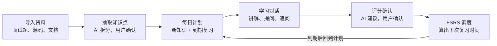

# 温故 · PRD v0.1

## 背景与定位

**一句话定位：别再背八股了。讲给 AI 听，它追问到你真懂为止，然后在你快忘的时候再来问你。**

**核心理念：学习的关键是输出，而不是反复看答案。** 温故和题库类产品的本质区别是：题库让用户看懂答案，温故让用户自己说出答案，由 AI 追问检验是否真懂，再由 FSRS 在快忘时安排复习。用户导入资料即可每天按计划学懂、记住，不需要会写 prompt，也不需要配置标签。

很多人想用 AI 学习，却不会用：不知道该问什么、学完就散、没有复习。墨墨背单词这类工具证明了“每天少量新知识 + 按记忆规律复习”的编排很有效，但它只适合可以死记的内容。

本项目把两者结合：AI 负责拆知识点、出题、追问、结合用户自己的项目讲解；调度算法（FSRS）负责决定每天学什么、什么时候复习。用户只需要导入资料，然后每天打开、完成当天任务。

**宽与窄：** 方法是通用的（输出 + AI 检验 + 间隔复习），切入点是窄的。第一版的内容和宣传只聚焦面试，但技术架构按通用学习设计，知识点、调度等核心模型不与“面试”绑定。以后扩展到其他学习领域是增加内容，不是重写系统（见“学习原则”最后一段）。

**差异化：**

| 产品类型 | 有什么 | 缺什么 |
| --- | --- | --- |
| 题库类 | 内容 | 记忆调度：看过就算，不知道什么时候该复习 |
| AI 模拟面试类 | 追问 | 用完即止：不记录、不安排复习 |
| 通用间隔复习工具 | 记忆调度 | 不懂面试：只能翻卡片自评，检验不了是否真懂 |

温故的重点是把 FSRS 调度和 AI 判断是否真懂结合起来，并长期追踪。

**同类开源项目：** JavaGuide 的 InterviewGuide 等开源项目和温故的技术栈几乎一样，技术栈本身不是亮点。亮点要放在 FSRS 建模、AI 评判与调度的结合上。

## 目标用户与使用场景

**第一版目标用户：国内计算机专业、Java 后端方向的学生**，包括正在学 Java 的低年级学生和准备求职的高年级学生。他们同时面对“八股文”和“项目深挖”两类问题，手里有面试题、项目源码和学习资料，但缺少系统的复习安排。用户的主要来源是手机（见“上线前需要评估”）。

典型场景：

- 每天花 30～60 分钟准备面试，打开就知道今天学哪几个知识点、复习哪几个。
- 面试前想把自己项目里的代码真正讲清楚，而不是只背项目介绍。
- 资料散落在 PDF、笔记和代码里，希望一次导入、统一管理。

**第一版的第一个用户就是项目作者本人**，先自用验证闭环，再开放给其他人。

## 核心使用流程

用户只在开始时导入一次资料，之后每天的使用都在闭环里转：打开计划、逐个对话学习、确认评分，调度算法决定它下次什么时候再出现。

对应的用户故事：作为准备面试的学生，我希望每天打开就知道该学什么，学完一个知识点就能确认掌握程度，而不用自己记哪些该复习了。

## 学习原则

设计学习流程时以下面六条为依据。它们和学什么无关，是以后扩展到其他学习方向时不变的部分：

| 原则 | 意思 | 在温故中的体现 |
| --- | --- | --- |
| 从已有知识出发 | 新知识要挂在旧知识上；基础缺了，学得又慢又浅 | 对话先摸底；不会的基础成为候选知识点 |
| 小步、少量 | 一次只能处理几块新信息 | 知识点粒度标准；每次只讲一小段；对话轮数有上限 |
| 先想后讲 | 先让学生猜、推理，再讲解，记得更牢 | 摸底、“下一步会发生什么” |
| 主动回忆 + 反馈 | 回忆比重读有效，也是唯一可靠的检验：听懂不等于能讲出来 | 检验、追问、完整作答、复习 |
| 间隔 | 分散到多天学，比一次学很久有效 | FSRS 调度 |
| 针对薄弱点 | 练还不会的，不重复已经会的 | 复习时针对上次没掌握的点提问 |

**从问题倒推着学**：以面试题为起点，只学回答它需要的内容，遇到不会的就顺着问下去。目标明确、效率高，但容易零散、学完就忘，所以要配上两件事：完全没有基础时，先讲最少必要的基础；倒推中新接触到的内容，收进复习计划（“接着问”和候选知识点）。

不同学习方向的区别主要在“回忆”的形式：面试题和概念原理要**讲出来**，数学和算法要**做出来**，外语要**用出来**，网安、嵌入式、游戏开发等技能要**动手做**，单词和公式只需**记住**。扩展到其他方向时，闭环不变，主要是增加知识点类型（各有自己的教法和检验方式）和导入方式。

## AI 的原则

技术上的做法（模型接入、Agent 的安全原则）见技术方案“AI 模块的原则与阶段”。

- **固定流程优先**：能用固定流程解决的 AI 功能，不做成 Agent。固定流程包括：答题评判（AI 点评并建议评分，用户确认）、知识点内的讲解追问、导入出题
- **Agent 的定位**：不做开放式问答助手，而是“有目标、有数据、能动手的备考教练”。判断标准：**这件事用户直接问自己的 AI 能做得一样好吗？能就不做**
- **作答方式：输出是核心。** 主路径保持让用户自己作答，不提供“只看答案自评”作为主路径。降低作答成本的方向是语音作答：第一阶段依靠手机输入法的语音输入，不自行接入语音识别

## 功能范围（MoSCoW）

判断标准只有一个：**没有这个功能，“导入资料 → 每日学习 → 评分调度”的闭环还能跑通吗？** 能跑通，就不是 Must。

| 功能 | 优先级 | 版本 | 说明 |
| --- | --- | --- | --- |
| 资料导入：面试题文本、PDF / Markdown / DOCX | Must | M1 | PDF 只解析文字，不做扫描件 OCR |
| 账号注册登录 | Must | M1 | 自部署和线上都要注册登录，不设管理员；是否开放注册由环境变量控制，见决策 017 |
| AI 抽取知识点，用户确认后加入；知识点可编辑、删除、合并、暂停 | Must | M1 | 零配置的核心，质量在 M0 先验证；确认时只能取消勾选，编辑、合并在知识库中进行 |
| 每日计划：每天学习总量（含复习），复习优先，新学补足剩余名额 | Must | M1 | 用户只需设置“每天学几个”这一个数字。M1 实现的是“新知识上限 + 到期复习”，这条规则由 M2 的 #85 改成现在的样子（来自自用反馈） |
| 学习对话：讲解、提问、追问，流式输出 | Must | M1 | 后端用 SSE 推送 |
| 结束评分：AI 建议四档评分，用户确认后更新 FSRS | Must | M1 | 忘了 / 困难 / 良好 / 简单 |
| 接着问：收尾后继续自由提问，不影响评分 | Must | M1 | 想继续往下挖的学生不被轮数上限拦住，见决策 008 |
| 候选知识点：学完后把不会的、超出范围的内容列出来，用户确认后加入知识点 | Should | M2（#90 之后） | 按本表的 Must 标准，它不是 Must：没有它，闭环也能跑通（决策 038）。源码导入实验（#89）发现源码题对基础薄弱的学习者太陡，M2 扩展为前置知识点：缺口和源码题的前置卡生成草稿，计划把前置知识点排在依赖它的知识点前面（决策 046）。复用草稿确认流程，见决策 008。原定 M1，2026-11-05 移出：作者自用中很少用接着问，验证提炼方式所需的约 10 次真实对话攒不起来，需求本身也有待自用中确认；评分建议中的缺口（outOfScopeGaps）每次评分都有，可以先只做这一个来源（#31） |
| 复习时换角度出题，不重复原题 | Must | M1 | 防止退化成背答案 |
| 模型配置：用户自带 API Key，兼容 OpenAI 格式与 Ollama | Must | M1 | 自部署版的唯一模型来源；M1 通过环境变量配置，整个部署共用一套；每个用户自带 Key 与加密存储在 M4，见决策 007、017 |
| 学习会话自动计时 | Must | M1 | 记录开始、结束时间和知识点，无需手动填写；长时间没有输入的时间不计入 |
| 这个我会，直接完整作答 | Should | M1 | 跳过讲解，直接完整作答并照常评分，见决策 018 |
| 接下来 7 天要复习的 | Should | M1 | 今天页右侧栏，每天到期的数量 |
| 老师的称呼 | Could | M2 | 只改显示名称和模型自称，讲解方式不变（#53） |
| 从一个问题开始 | Should | 之后（M2 末看自用数据决定） | 不依附已有知识点，以接着问的方式学习，结束时整理成候选知识点，见决策 018（#54，由 #91 决定去留） |
| 源码导入 | Should | M2 | 与源码追问一起做，见决策 007 |
| 复习时结合用户源码追问 | Should | M2 | 核心差异化，先在自用中打磨 |
| 模型降级链：失败或 429 时切换备用模型 | Should | M4 |  |
| 学习统计：学习时长、连续学习天数 | Should | M2 | 最小版（#87）。时长来自自动计时；连续学习的口径见决策 020 |
| 学习统计的其余部分：知识库掌握分布、还要几天学完、按知识点类型统计用时并建议每天学几个、按日期回看答过的题（#82 第二步） | Should | 之后 |  |
| 按参考答案重写要点 | Should | M3 | 用户手上有参考答案时，照着它改写要点；生产默认卡组时用得上 |
| 截图导入题目：多模态模型识别图中文字 | Should | M2 | 需模型支持图片输入，不支持时提示用户（#88） |
| 平台免费额度 + 用量统计与限流 | Must（线上） | M4 | Redis 计数；必要时用邀请码或排队控制节奏 |
| 用户 API Key 加密存储 | Must（线上） | M4 | 见“关键约束” |
| 知识点依赖关系 | Could | 之后 |  |
| GitHub 仓库链接导入 | Could | 之后 |  |
| RAG 向量检索 | Could | 之后 | 资料量大到放不进上下文时再引入 |

## 版本规划

自部署和线上都要做，但按顺序来：**先用自部署版验证闭环，再加免费额度和用户自带 Key。** 线上版涉及计费和 Key 安全，工作量不小，提前做容易拖住核心功能。账号注册登录在 M1 就做，自部署和线上用同一种模式（决策 017）。

| 阶段 | 内容 | 进入下一阶段的关卡 |
| --- | --- | --- |
| M0 技术验证 | 测试知识点抽取 prompt；移植 FSRS 并测试 | 抽取质量达标 |
| M1 自部署闭环 | 实现全部 Must 功能；注册登录，Docker 启动 |  |
| M2 自用与开源 | 连续自用并修问题；每天学习总量、评分修改等自用反馈；Session 存进 Redis；统计最小版；老师的称呼；截图导入；源码导入与追问；前置知识点；自用数据复盘；写 README 并发布 | 连续自用 7 天（按决策 020 的口径，从第一个完成全部任务的学习日起算，决策 046）；自部署版 v0.1 发布 |
| M3 默认卡组与技能体系 | 默认卡组（草案见“待决问题”）；技能体系（决策 033）；按参考答案重写要点；系统设计题的学法；前置知识点在 M2 先做（决策 046） |  |
| M4 线上版 | 免费额度与限流；用户自带 Key 与加密存储；模型降级链；“上线前必须完成”清单，含主体与合规 |  |

**目标：** 2027 年 2 月上中旬内测，2 月底公开上线，赶在春招和暑期实习招聘之前。

每个关卡没过，就先不进入下一阶段。例外是 M3 可以和 M2 的关卡并行开始：M2 的关卡只挡自用数据复盘（#91）和发布 v0.1（#92），不挡开发（决策 046）。各阶段不写周数：依赖使用数据的事按“攒够多少次使用”来排（M1 复盘）。里程碑的调整见决策 038、046。

**M1 的“开始自用”线：** 下面这些完成后，作者开始每天自用（M2 的 7 天不从这里算，见上表）：账号与登录、前端骨架、今天页（含所需接口）、学习会话与对话、结束评分、导入资料与确认知识点、学习 / 收尾 / 接着问页面。其余的 M1 功能边用边做：知识库（列表、编辑、删除、合并、暂停）、设置页、大模型错误提示、复习时换角度提问、文档导入、Docker 一键启动。候选知识点和可选的老师的称呼、从一个问题开始，2026-11-05 移出 M1（现在的去向见上面功能表）。

## 上线前必须完成

公开上线之前，下面这些都要完成。内测（2 月上中旬）面向熟人、规模小，只要求有反馈渠道和简单统计（见“成功指标”）：

- 7 种知识点类型都能学，不再有“只收录”（M1 中系统设计、个人经历暂时不能学，见决策 007；个人经历在 M2 完成，系统设计在 M3 完成）
- 免费额度与限流
- 用户自带 Key 与加密存储
- 绑定邮箱、找回密码、防批量注册
- 用户协议和隐私政策
- 反馈入口：设置中常驻，出错提示中有“反馈这个问题”；自动附带页面、时间、错误编号，不附带对话和资料，除非用户勾选
- Session 改为 Spring Session + Redis 存储，避免每次发版重启后所有用户掉线（决策 022 原本列为多实例部署时才处理，见决策 034）。M2 提前完成（#86）：自用时每次重启后端都要重新登录
- 主体与合规：公开推广前换成个体工商户主体并重新备案；查清面向公众的生成式 AI 服务的合规要求；ICP 下来后 30 天内做公安联网备案。作者已有云服务器和域名，备案进行中（2026-11）

## 上线前需要评估

- **手机浏览器上的核心路径（今天、学习、评分）是否好用**：导航能否直接到达、触屏能否顺畅操作。用户的主要来源是手机。评估时可参考的建议见决策 034 第 5 节（只是建议，未决定）；ui.md 的设计原则在评估之后再改

## 明确不做与想法池

**第一版明确不做：** 由用户手动创建和维护的标签、分类系统（知识点的技能归属由系统图谱和 AI 决定，用户只确认，不配置，见决策 033）、手动番茄钟、产品内用户之间的题库分享（官方图谱和知识点模板放在仓库中，接受 PR 贡献，见决策 033）、移动端 App（以后的小程序见决策 034）、MCP 集成、多人协作。

想法池（新想法先记在这里，MVP 之后再评估）：

- 手动专注计时与自定义备注
- 把温故做成 MCP Server：让用户在自己的 AI 客户端（Claude Code 等）中查询学习数据，也可以在其中学习
- 题库市场：用户分享整理好的知识点集合
- 根据会话时长自动调整知识点难度
- 组队学习打卡（M4 之后评估）：2～3 人，参考墨墨背单词，通过邀请链接加入。只打卡不聊天：组员能看到彼此当天是否完成和连续天数，有小组连续天数（全员完成才算一天）；轻互动只用预设内容（“催一下”每天限一次、完成后的固定回应），不开放自由文字；组员各按自己的学习日；组内只共享打卡结果，不共享知识点和资料。连续的口径与个人连续学习相同，见决策 020
- 个人经历题在没有源码时，AI 帮用户梳理经历（问题、选择、结果），M2 与源码追问一起考虑
- 简历防守：简历作为输入，拆成一条条声明，生成需要扛住的追问并进入复习；不做简历编辑器。个人经历类知识点可作为它的基础
- 技能树页面：导航中单开一项，和今天、知识库并列，技能点亮带来成就感和正反馈（技能体系的数据和亮度计算在 M3，见决策 033）
- 技能树的来源：根据 JD 生成；用户添加技术栈；或者做一个技术栈库，用户直接选，并支持自定义。其中用户添加、自定义的部分和“用户只确认，不配置”有冲突，见决策 033“待讨论”
- JD 匹配与面试冲刺规划
- 基于用户项目和薄弱知识点的模拟面试，结束后自动生成复习内容
- 面经复盘：用户贴入真实面试被问到的题，整理成知识点并诊断薄弱点
- 把用户和其他 AI 的对话导入，提炼成知识点
- 小程序（每日复习）：uni-app，与网页共用后端，只连接线上版，见决策 034；要先查个人主体能否选 AI 相关类目
- 部分功能以后做成会员专属（需要个体户或公司主体）
- 扩展到面试以外的学习方向（考研四大件、资格考试、网安、嵌入式、游戏开发、外语、数学等）：核心闭环与领域无关，见“学习原则”和“背景与定位”中的“宽与窄”；需要补充大纲导入、按方向增加知识点类型（计算题练习与判分、外语产出反馈等）、按考试日期安排复习

## 关键约束

**费用：** 自部署版只用用户自己的 API Key 或本地模型，作者零成本。线上版提供少量免费额度，额度用完后引导用户填自己的 Key；每个用户的用量按天计数并限流，防止被刷。

**模型：** 线上版部署在中国内地，因此线上版只支持国内模型。自部署版不受此限制，兼容 OpenAI 格式的服务和本地 Ollama 都可以用（决策 004）。

**API Key 安全：** 用户 Key 加密后入库，加密密钥放在环境变量里，不写进代码和数据库；接口返回时只显示末四位；日志中不打印 Key。

**隐私：** 用户上传的源码和资料只用于该用户自己的学习，不用于其他用途；自部署版数据完全留在用户机器上，这是面向开发者的重要卖点。

**架构要求：** 自部署和线上用同一套代码，只有多用户模式：都要注册登录，不设管理员，是否开放注册由环境变量控制，避免维护两个版本。界面上不出现部署和配置相关的文字，这些写在 README，见决策 017。

## 验收标准与成功指标

M1 完成的标准：

- [x] 用 `docker compose up` 一条命令能在本地启动（决策 036：从仓库重新 clone 后按 README 启动并走完完整流程）
- [x] 导入一份 20 道左右的面试题，能抽出粒度合理的知识点，人工修改不超过三成（决策 006：M0 用 30 道题实测 v3 约 12%，v5 估计 10%～20%）
- [x] 每日计划按设定的新知识数量和到期复习正确生成（决策 016：PlanServiceTest 用真实 MySQL 和可拨动的时钟验证；作者每天自用）
- [x] 完成一次学习对话并确认评分后，下次复习时间按 FSRS 正确更新（决策 003：与 py-fsrs 逐条比对 240 个用例；自用中评分后的复习日期符合预期）
- [x] 复习同一知识点时，问题与上次不同（决策 035：2026-11-05 自用中的第一次真实复习，开场换了角度，并针对上次没掌握的地方）

成功指标：

- 自用阶段：作者连续使用 7 天，每天都能完成当天任务（决策 020 的口径，决策 046）
- 开源阶段：README 有完整的演示截图或 GIF，至少 5 位外部用户成功部署并反馈
- 内测阶段：
  - 准备春招的学长学姐：看能否坚持用一周
  - 在互联网公司工作的亲友：以面试官视角审核默认卡组和 AI 评分
  - 学校老师：验证这套方法能否用于课程学习
  - 内测前要建好反馈渠道（微信群），并做简单统计（每天复习多少、在哪一步退出）
- 线上阶段：衡量指标和需要埋点的统计项，**待讨论**（见“待决问题”）

## 待决问题

- [x] 项目名称：温故（WenGu），GitHub 仓库名 wengu-learn
- [x] 一个“知识点”的粒度标准是什么？以真实面试题的提问粒度为参照，M0 已用 30 道样本题验证（人工修改约 12%），标准见技术方案“知识点粒度与类型”和决策 006
- [x] 评分不一致：以用户确认的评分为准，AI 建议评分同时记录，供以后分析判断准确度
- [x] 源码过大：M2 做源码导入时，由用户在导入时勾选要学习的文件，并限制总大小，自动选取以后再做
- [ ] 线上版免费额度的具体数量，以及用哪家模型提供（只能是国内模型，见“关键约束”）
- [ ] **默认卡组（草案，未定）**：在 M3，技能体系的实现跟随它（决策 033）
  - 目的：新用户冷启动、技能亮度的分母、演示内容、答案经过核对
  - 规模：第一版 150～200 个知识点，6～8 个技能；“必会”一档约 60～80 个，先做先审
  - 来源：题目用通用问法，要点由 AI 起草、人工审核，不照搬其他题库的答案；选题参考 JD 统计、面经高频题、作者现有的知识点
  - 生产：用温故自己的导入流程生成，作者在每日学习中审核，专家抽审“必会”一档并评估 AI 评分
  - 存放：放在仓库中，用 slug 标识、带版本号，启动时同步进数据库，记录审核状态
  - 未定：覆盖哪些技能；审核人有多少时间；内容用什么许可证（代码是 AGPL，内容可能另用 CC 协议）；“必会”的粒度（决策 033 的重要程度标在技能上，这里按知识点数）
- [ ] **待讨论**：产品衡量指标和需要埋点的统计项。候选指标：每周至少复习 3 天的用户比例
- [ ] **待讨论**：Embedding 方案。初步想法是在服务器上用小型中文开源模型、向量存 Redis，尚未确定。补充提议：在服务器上用 ONNX 跑小型中文模型（如 bge-small-zh），用户只需配置对话模型；源码检索按类和方法切块，向量检索和关键词检索混用，再给模型一个“读文件”工具。M2 的源码导入由用户勾选文件、限制总大小，内容放得进上下文，所以暂时不需要
