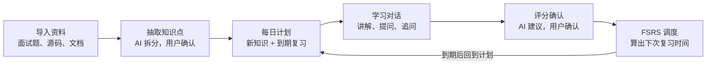

# 温故 · PRD v0.1

## 背景与定位

**一句话定位：把“用 AI 追问式学习”和“间隔重复编排”打包成产品，用户导入资料即可每天按计划学懂、记住，不需要会写 prompt，也不需要配置标签。**

很多人想用 AI 学习，却不会用：不知道该问什么、学完就散、没有复习。墨墨背单词这类工具证明了“每天少量新知识 + 按记忆规律复习”的编排很有效，但它只适合可以死记的内容。

本项目把两者结合：AI 负责拆知识点、出题、追问、结合用户自己的项目讲解；调度算法（FSRS）负责决定每天学什么、什么时候复习。用户只需要导入资料，然后每天打开、完成当天任务。

## 目标用户与使用场景

**首要用户：准备技术面试的计算机专业学生和初级开发者。** 他们同时面对“八股文”和“项目深挖”两类问题，手里有面试题、项目源码和学习资料，但缺少系统的复习安排。

典型场景：

- 每天花 30～60 分钟准备面试，打开就知道今天学哪几个知识点、复习哪几个。
- 面试前想把自己项目里的代码真正讲清楚，而不是只背项目介绍。
- 资料散落在 PDF、笔记和代码里，希望一次导入、统一管理。

**第一版的第一个用户就是项目作者本人**，先自用验证闭环，再开放给其他人。

## 核心使用流程

用户只在开始时导入一次资料，之后每天的使用都在闭环里转：打开计划、逐个对话学习、确认评分，调度算法决定它下次什么时候再出现。

对应的用户故事：作为准备面试的学生，我希望每天打开就知道该学什么，学完一个知识点就能确认掌握程度，而不用自己记哪些该复习了。

## 学习原则

设计学习流程时以下面六条为依据。它们和学什么无关，是以后扩展到其他学习方向时不变的部分：

| 原则 | 意思 | 在温故中的体现 |
| --- | --- | --- |
| 从已有知识出发 | 新知识要挂在旧知识上；基础缺了，学得又慢又浅 | 对话先摸底；不会的基础成为候选知识点 |
| 小步、少量 | 一次只能处理几块新信息 | 知识点粒度标准；每次只讲一小段；对话轮数有上限 |
| 先想后讲 | 先让学生猜、推理，再讲解，记得更牢 | 摸底、“下一步会发生什么” |
| 主动回忆 + 反馈 | 回忆比重读有效，也是唯一可靠的检验：听懂不等于能讲出来 | 检验、追问、完整作答、复习 |
| 间隔 | 分散到多天学，比一次学很久有效 | FSRS 调度 |
| 针对薄弱点 | 练还不会的，不重复已经会的 | 复习时针对上次没掌握的点提问 |

**从问题倒推着学**：以面试题为起点，只学回答它需要的内容，遇到不会的就顺着问下去。目标明确、效率高，但容易零散、学完就忘，所以要配上两件事：完全没有基础时，先讲最少必要的基础；倒推中新接触到的内容，收进复习计划（“接着问”和候选知识点）。

不同学习方向的区别主要在“回忆”的形式：面试题和概念原理要**讲出来**，数学和算法要**做出来**，外语要**用出来**，网安、嵌入式、游戏开发等技能要**动手做**，单词和公式只需**记住**。扩展到其他方向时，闭环不变，主要是增加知识点类型（各有自己的教法和检验方式）和导入方式。

## 功能范围（MoSCoW）

判断标准只有一个：**没有这个功能，“导入资料 → 每日学习 → 评分调度”的闭环还能跑通吗？** 能跑通，就不是 Must。

| 功能 | 优先级 | 版本 | 说明 |
| --- | --- | --- | --- |
| 资料导入：面试题文本、PDF / Markdown / DOCX | Must | M1 | PDF 只解析文字，不做扫描件 OCR |
| AI 抽取知识点，用户可预览、删除、合并、编辑 | Must | M1 | 零配置的核心，质量在 M0 先验证 |
| 每日计划：新知识上限 + 到期复习 | Must | M1 | 用户只需设置“每天新学几个”这一个数字 |
| 学习对话：讲解、提问、追问，流式输出 | Must | M1 | 后端用 SSE 推送 |
| 结束评分：AI 建议四档评分，用户确认后更新 FSRS | Must | M1 | 忘了 / 困难 / 良好 / 简单 |
| 接着问：收尾后继续自由提问，不影响评分 | Must | M1 | 想继续往下挖的学生不被轮数上限拦住，见决策 008 |
| 候选知识点：学完后把不会的、超出范围的内容列出来，用户确认后加入知识点 | Must | M1 | 复用草稿确认流程，见决策 008 |
| 复习时换角度出题，不重复原题 | Must | M1 | 防止退化成背答案 |
| 模型配置：用户自带 API Key，兼容 OpenAI 格式与 Ollama | Must | M1 | 自部署版的唯一模型来源；M1 通过环境变量配置，设置页与加密存储在 M3，见决策 007 |
| 学习会话自动计时 | Must | M1 | 记录开始、结束时间和知识点，无需手动填写；长时间没有输入的时间不计入 |
| 源码导入 | Should | M2 | 与源码追问一起做，见决策 007 |
| 复习时结合用户源码追问 | Should | M2 | 核心差异化，先在自用中打磨 |
| 模型降级链：失败或 429 时切换备用模型 | Should | M2 |  |
| 学习统计：每日时长、连续天数、掌握分布 | Should | M2 | 数据来自自动计时 |
| 截图导入题目：多模态模型识别图中文字 | Should | M2 | 需模型支持图片输入，不支持时提示用户 |
| 账号注册登录 | Must（线上） | M3 | Spring Security + JWT |
| 平台免费额度 + 用量统计与限流 | Must（线上） | M3 | Redis 计数 |
| 用户 API Key 加密存储 | Must（线上） | M3 | 见“关键约束” |
| 知识点依赖关系 | Could | 之后 |  |
| GitHub 仓库链接导入 | Could | 之后 |  |
| RAG 向量检索 | Could | 之后 | 资料量大到放不进上下文时再引入 |

## 版本规划

自部署和线上都要做，但按顺序来：**先用自部署版验证闭环，再加多用户和免费额度。** 线上版涉及账号、计费和 Key 安全，工作量不小，提前做容易拖住核心功能。

| 阶段 | 预计时长 | 内容 | 进入下一阶段的关卡 |
| --- | --- | --- | --- |
| M0 技术验证 | 约 1 周 | 测试知识点抽取 prompt；移植 FSRS 并测试 | 抽取质量达标 |
| M1 自部署闭环 | 约 5 周 | 实现全部 Must 功能；单用户，Docker 启动 |  |
| M2 自用与开源 | 约 2 周 | 连续自用并修问题；源码导入与追问、统计；写 README 并发布 | 连续自用 14 天（从 M1 的计划页和对话页完成后开始算） |
| M3 线上版 | 视反馈而定 | 账号与多用户模式；免费额度与限流；Key 加密存储 |  |

每个关卡没过，就先不进入下一阶段；周数是预估，按实际进度调整。

## 明确不做与想法池

**第一版明确不做：** 标签和分类系统、手动番茄钟、社区与题库分享、移动端 App、MCP 集成、多人协作。

想法池（新想法先记在这里，MVP 之后再评估）：

- 手动专注计时与自定义备注
- 把核心能力做成 MCP Server，在 Claude Code 等工具里学习
- 题库市场：用户分享整理好的知识点集合
- 根据会话时长自动调整知识点难度
- 扩展到其他学习方向（考研四大件、资格考试、网安、嵌入式、游戏开发、外语、数学等）：核心闭环与领域无关，见“学习原则”；需要补充大纲导入、按方向增加知识点类型（计算题练习与判分、外语产出反馈等）、按考试日期安排复习

## 关键约束

**费用：** 自部署版只用用户自己的 API Key 或本地模型，作者零成本。线上版提供少量免费额度，额度用完后引导用户填自己的 Key；每个用户的用量按天计数并限流，防止被刷。

**API Key 安全：** 用户 Key 加密后入库，加密密钥放在环境变量里，不写进代码和数据库；接口返回时只显示末四位；日志中不打印 Key。

**隐私：** 用户上传的源码和资料只用于该用户自己的学习，不用于其他用途；自部署版数据完全留在用户机器上，这是面向开发者的重要卖点。

**架构要求：** 自部署和线上用同一套代码，通过配置切换“单用户模式 / 多用户模式”，避免维护两个版本。

## 验收标准与成功指标

M1 完成的标准：

- [ ] 用 `docker compose up` 一条命令能在本地启动
- [ ] 导入一份 20 道左右的面试题，能抽出粒度合理的知识点，人工修改不超过三成
- [ ] 每日计划按设定的新知识数量和到期复习正确生成
- [ ] 完成一次学习对话并确认评分后，下次复习时间按 FSRS 正确更新
- [ ] 复习同一知识点时，问题与上次不同

成功指标：

- 自用阶段：作者连续使用 14 天，每天都能完成当天任务
- 开源阶段：README 有完整的演示截图或 GIF，至少 5 位外部用户成功部署并反馈

## 待决问题

- [x] 项目名称：温故（WenGu），GitHub 仓库名 wengu-learn
- [x] 一个“知识点”的粒度标准是什么？以真实面试题的提问粒度为参照，M0 已用 30 道样本题验证（人工修改约 12%），标准见技术方案“知识点粒度与类型”和决策 006
- [x] 评分不一致：以用户确认的评分为准，AI 建议评分同时记录，供以后分析判断准确度
- [x] 源码过大：M2 做源码导入时，由用户在导入时勾选要学习的文件，并限制总大小，自动选取以后再做
- [ ] 线上版免费额度的具体数量，以及用哪家模型提供
