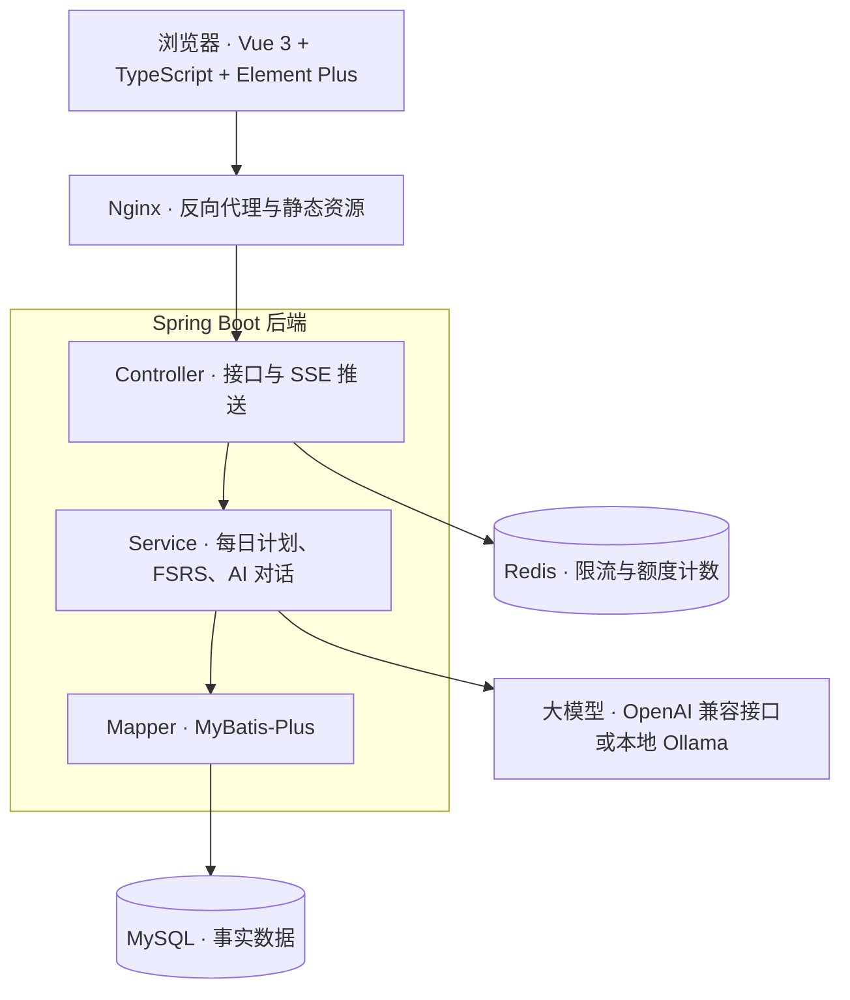
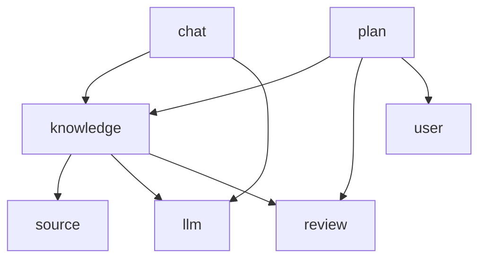

# 温故 · 技术方案 v0.1

本文档是 [PRD](./prd.md) 之后的技术层设计。

## 架构概览

**第一版是一个单体 Spring Boot 应用，按 Controller / Service / Mapper 三层分层。** 不拆微服务，部署和调试都最简单。



Redis 在接口入口处做限流；调用大模型和 FSRS 调度都在 Service 层，AI 的回复由 Controller 通过 SSE 逐字推给浏览器。

## 技术栈

原则：**选作者熟悉的技术，亮点放在产品设计和 AI 部分，不在技术栈上冒险。**

| 层 | 选型 | 理由 |
| --- | --- | --- |
| 后端框架 | Spring Boot 4，Java 21，Maven | 作者最熟悉，也贴合 Java 后端面试；Spring AI 2.x 要求 Spring Boot 4 |
| 持久层 | MyBatis-Plus + MySQL | 熟悉；MVP 不需要向量检索 |
| 安全 | Spring Security + JWT | 仅多用户模式启用 |
| 缓存 / 计数 | Redis | 只用于 AI 接口限流、线上免费额度计数，不做过早缓存 |
| 大模型接入 | Spring AI 2.x | Spring 官方项目，用法与其他 starter 一致；兼容 OpenAI 格式与 Ollama |
| 流式输出 | SSE | 单向推送，比 WebSocket 简单 |
| 调度算法 | FSRS，自行移植为 Java | 用 Python 版输出做单元测试校验 |
| 文档解析 | Apache PDFBox、Apache POI | PDF 与 DOCX 文字提取 |
| 前端 | Vue 3 + TypeScript + Vite + Element Plus | 上手平缓；TS 是前端主流，静态类型对 Java 背景更友好，也让 AI 写的代码更好读、错误在编译时暴露 |
| 部署 | Docker Compose + Nginx | 一条命令启动 |

## 包结构与分层约定

**按业务分包（模块化单体）**，每个模块内部再分 controller / service / mapper / entity / dto。

```
com.wengu
├── source      资料导入与解析
├── knowledge   知识点
├── plan        每日计划
├── review      评分与调度
│   └── fsrs    FSRS 算法（纯 Java）
├── chat        学习会话与对话
├── llm         大模型接入、降级链
├── user        用户与设置
└── common      统一返回、全局异常、工具类
```

约定：

- 模块之间只能调用对方的 Service，不能直接使用对方的 Mapper 或访问对方的表，为以后拆分保留边界
- review.fsrs 只放纯计算代码：不加 Spring 注解、不访问数据库，输入当前状态和评分、输出新状态，用 Python 版结果做单元测试
- 依赖方向单向，不允许循环依赖，完整关系见下图和 [决策 002](./decisions/002-模块依赖边界.md)
- review 只通过 kp_id 工作，不依赖 knowledge；知识点创建时由 knowledge 调用 review 初始化调度状态
- llm 是底层模块，管理 model_config，不依赖任何业务模块
- 当前用户 id 由 common 提供（单用户模式返回默认用户），各模块不为此依赖 user



所有模块都可以依赖 common，图中省略。

## 数据模型

所有业务表都带 user_id，单用户模式下只有一个默认用户，切换多用户时表结构不变。时间统一存 UTC。

| 表 | 作用 | 关键字段 |
| --- | --- | --- |
| user | 用户 | id、username、password_hash |
| user_settings | 用户设置 | user_id、daily_new_limit（每天新学数量）、timezone、day_start_hour（一天的分界，默认 4 点） |
| source | 导入的学习材料 | id、user_id、type（题目 / 源码 / 文档 / 截图）、name、content |
| knowledge_point | 知识点（很少变） | id、user_id、type（知识点类型，见下文）、title（写成一个问题）、summary、status（正常 / 暂停） |
| kp_source | 知识点与材料的多对多关联 | kp_id、source_id |
| card_state | 调度状态（每次复习都更新） | kp_id、user_id（冗余）、state、due、stability、difficulty、reps、lapses、last_review |
| study_session | 一次学习会话，也是自动计时的来源 | id、user_id、kp_id、started_at、ended_at |
| message | 会话中的对话消息 | id、session_id、role、content、created_at |
| review_log | 每次评分的流水 | id、user_id、kp_id、session_id、rating_user、rating_ai、state_before、reviewed_at |
| model_config | 模型配置 | user_id、base_url、model、api_key_encrypted |

关键索引：

- card_state 建联合索引 (user_id, due)，用于查询“某用户所有到期的知识点”
- review_log 建联合索引 (user_id, reviewed_at)，用于统计今天已学的新知识和学习历史
- message 建索引 (session_id, created_at)，用于按顺序取出会话上下文

## 每日计划的计算逻辑

**每日计划不建表，每次打开时实时计算。** 它是派生数据，事实已经存在 card_state 和 review_log 里。

计算步骤：

1. 根据用户时区和 day_start_hour，算出“今天”的起止时间（换算成 UTC）。
2. 到期复习：查 card_state 中 user_id 匹配、state 不是“新”、且 due 早于今天结束时间的知识点。
3. 今天已学的新知识数：查 review_log 中今天范围内、state_before 为“新”的记录条数。
4. 剩余新知识名额 = daily_new_limit − 第 3 步的数量，小于 0 时取 0。
5. 新知识：从 state 为“新”的知识点中按创建时间取出剩余名额数量。
6. 返回：到期复习列表 + 新知识列表，先复习后新学。

第 3 步是防止重复派发的关键：如果不扣除今天已学的新知识，用户下午再打开页面时会被重新分配一批新知识，每日上限就失效了。

复习完的知识点 due 会被推到未来，自然不会再出现在第 2 步的结果里，无需额外处理。

## 关键设计决策

每条决策写清楚选了什么、为什么、放弃了什么，方便以后回顾和面试复述。新的决策记录在 `docs/decisions/` 下。

| 决策 | 理由 | 放弃的方案 |
| --- | --- | --- |
| 存事实，算派生：每日计划实时计算 | 避免两份数据不同步；查询有索引，毫秒级 | 建 daily_plan 表存快照 |
| card_state 与 knowledge_point 拆开 | 内容很少变，调度状态频繁更新，职责不同；FSRS 字段可能随算法升级变化 | 合并成一张表 |
| card_state 冗余 user_id | 有意识的反范式，用一点冗余换取 (user_id, due) 单索引查询 | 每次关联 knowledge_point 筛选用户 |
| 状态表与流水表分离 | card_state 存“现在”，review_log 存“全部历史”，供统计和 FSRS 参数优化 | 只更新状态，不留历史 |
| 评分以用户确认为准，同时记录 AI 建议 | 用户最了解自己；保留差异以后可评估 AI 准确度 | 完全由 AI 评分 |
| 单用户 / 多用户同一套代码，用配置切换 | 只维护一个版本；默认单用户，开箱即用 | 维护两个分支 |
| Redis 只用于限流和额度计数 | 这些场景需要高频读写计数器；每日计划无需缓存 | 缓存每日计划（过早优化） |
| 流式输出用 SSE | AI 回复是单向推送，SSE 实现简单 | WebSocket |
| 按业务分包，FSRS 独立为纯 Java 子包 | 功能代码集中、依赖清晰、便于以后拆分；算法与副作用分离，方便单元测试 | 按层分包 |

## 知识点粒度与类型（初稿，M0 验证）

本节基于对 200 道 Java 后端面试题的分析。

**粒度标准：一个知识点 = 能在 3～5 分钟对话里讲清、用一个问题就能检验的概念。** 以面试的提问方式为参照：一道题和它的常见追问构成一条追问链，主问题和每个追问各算一个知识点。

抽取规则：

- **拆分**：原理类大题按追问链拆成多个知识点，例如 HashMap 原理拆为整体结构、引入红黑树的原因、负载因子、扩容机制等
- **合并**：多道题考同一内容时合并为一个知识点，通过 kp_source 关联所有来源题，例如“Spring 启动流程”和“Spring Boot 启动流程”
- **排序**：AI 按学习顺序输出知识点，新知识按创建顺序派发，暂不建依赖关系表

知识点类型（knowledge_point.type）：

| 类型 | 枚举值 | 识别特征 | 学习与复习方式 |
| --- | --- | --- | --- |
| 原子概念 | CONCEPT | 单一概念，如回表、CAS | 对话讲解，复习时换角度提问 |
| 对比 | COMPARISON | “A 和 B 的区别” | 追问差异和各自适用场景 |
| 原理机制 | MECHANISM | 流程或原理，常带追问链 | 深度对话，按顺序学习 |
| 列举 | ENUMERATION | “有哪些” | 偏记忆，快问快答 |
| 排查实战 | TROUBLESHOOTING | “线上出了问题怎么办” | 情景模拟，考察步骤和工具 |
| 系统设计 | SYSTEM_DESIGN | “设计一个 XX 系统” | 综合多个知识点；M1 只标记、不进入每日计划，以后做模拟面试 |
| 个人经历 | EXPERIENCE | “你项目里怎么做的” | 必须结合用户源码追问 |

加 type 字段的理由：不同类型的复习方式差别很大，用类型选择不同的对话 prompt，成本几乎为零，却直接决定学习体验。

## 待补充

- [ ] 接口设计：各模块的 URL、参数和返回值（M1 前确定）
- [ ] 知识点抽取、学习对话、评分建议三类 prompt 的设计（M0 中实验得出）
- [x] 后端包结构与分层约定
- [ ] M0 结论：用约 30 道样本题验证粒度标准和类型判断（初稿见上一节）
