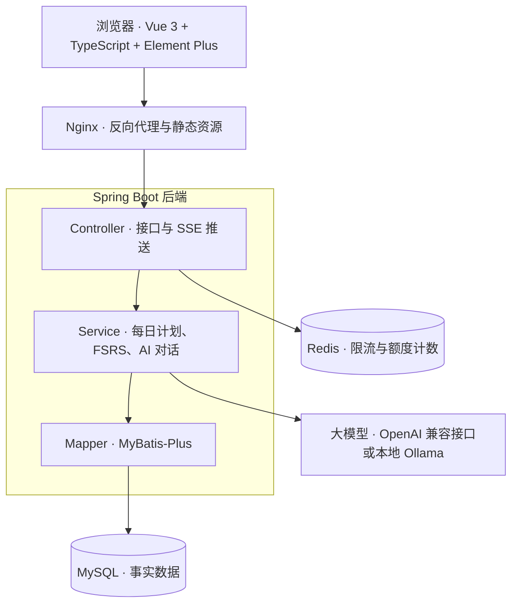
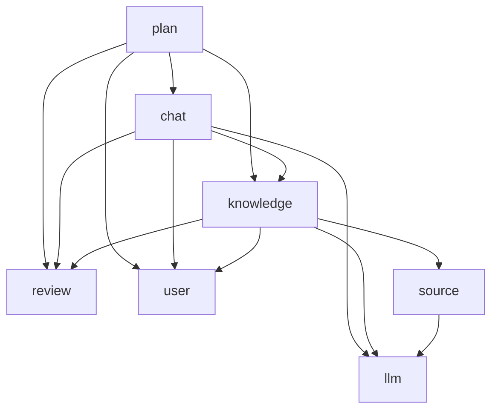

# 温故 · 技术方案 v0.1

本文档是 [PRD](./prd.md) 之后的技术层设计。

## 架构概览

**第一版是一个单体 Spring Boot 应用，按 Controller / Service / Mapper 三层分层。** 不拆微服务，部署和调试都最简单。



Redis 在接口入口处做限流；调用大模型和 FSRS 调度都在 Service 层，AI 的回复由 Controller 通过 SSE 逐字推给浏览器。

## 技术栈

原则：**选作者熟悉的技术，亮点放在产品设计和 AI 部分，不在技术栈上冒险。**

| 层 | 选型 | 理由 |
| --- | --- | --- |
| 后端框架 | Spring Boot 4，Java 21，Maven | 作者最熟悉，也贴合 Java 后端面试；Spring AI 2.x 要求 Spring Boot 4 |
| 持久层 | MyBatis-Plus + MySQL 8.4，Flyway 管理表结构 | 熟悉；MVP 不需要向量检索；表结构随代码版本化，见 [决策 009](./decisions/009-数据库迁移与表结构约定.md) |
| 测试数据库 | Testcontainers（MySQL 8.4） | 迁移脚本和时区处理要在真实的 MySQL 上测，H2 不可靠 |
| 安全 | Spring Security | 始终启用，只有多用户模式，见 [决策 017](./decisions/017-只保留多用户模式.md)；凭证为服务端 Session，见 [决策 022](./decisions/022-登录凭证与认证.md) |
| 缓存 / 计数 | Redis | 只用于 AI 接口限流、线上免费额度计数，不做过早缓存 |
| 大模型接入 | Spring AI 2.0.1（OpenAI starter） | Spring 官方项目，用法与其他 starter 一致；兼容 OpenAI 格式与 Ollama，见 [决策 004](./decisions/004-大模型接入.md) |
| 流式输出 | SSE | 单向推送，比 WebSocket 简单 |
| 调度算法 | FSRS-6，从 py-fsrs 6.3.2 移植为 Java | 用 Python 版输出做单元测试校验，见 [决策 003](./decisions/003-FSRS移植.md) |
| 文档解析 | Apache PDFBox 3.0.8、Apache POI 5.5.1 | PDF 与 DOCX 文字提取，见 [决策 037](./decisions/037-文档导入.md) |
| 前端 | Vue 3 + TypeScript + Vite + Element Plus | 上手平缓；TS 是前端主流，静态类型对 Java 背景更友好，也让 AI 写的代码更好读、错误在编译时暴露 |
| 部署 | Docker Compose + Nginx | 一条命令启动：mysql、backend、web（Nginx 提供前端并转发 /api）三个容器，多阶段构建，配置写在 `.env`；见 [决策 036](./decisions/036-Docker部署.md) |

## 包结构与分层约定

**按业务分包（模块化单体）**，每个模块内部再分 controller / service / mapper / entity / dto。

```
com.wengu
├── source      资料导入与解析
├── knowledge   知识点
├── plan        每日计划
├── review      评分与调度
│   └── fsrs    FSRS 算法（纯 Java）
├── chat        学习会话与对话
├── llm         大模型接入、降级链
├── user        用户与设置
└── common      统一返回、全局异常、工具类
```

约定：

- 模块之间只能调用对方的 Service，不能直接使用对方的 Mapper 或访问对方的表，为以后拆分保留边界
- review.fsrs 只放纯计算代码：不加 Spring 注解、不访问数据库，输入当前状态和评分、输出新状态，用 Python 版结果做单元测试
- 依赖方向单向，不允许循环依赖，完整关系见下图和 [决策 002](./decisions/002-模块依赖边界.md)
- review 只通过 kp_id 工作，不依赖 knowledge；知识点创建时由 knowledge 调用 review 初始化调度状态，结束评分时由 chat 调用 review 更新调度状态、写评分流水
- llm 是底层模块，管理 model_config，不依赖任何业务模块
- 当前用户 id 由 common 提供（从登录信息读取），各模块不为此依赖 user。只在 Controller 中读取，传给 Service：登录信息只在请求线程上，后台线程和 SSE 的异步线程读不到（决策 022）



所有模块都可以依赖 common，图中省略。

**规划中的模块（M3，未实现）：**技能体系（[决策 033](./decisions/033-技能体系.md)）会新增 `skill`（图谱、技能、知识点模板，只依赖 common）和 `progress`（暂名，技能亮度的计算，依赖 knowledge、review、skill），knowledge 新增依赖 skill。实现时再修订决策 002 和上图。

## 接口与后端约定

从现在起新写的接口和后端代码都要遵守，原因见 [决策 034](./decisions/034-多端策略与接口约定.md)。前几条现有代码已经在这样做：

- **接口只做向后兼容的修改**：可以新增字段，不删除、不重命名已有字段；确需破坏性修改时新增接口版本，旧版本保留一段时间。小程序的旧版本会在用户手机上长期存在
- **Service 只接收 userId，不读取 Session**：当前用户只在 Controller 中通过 `CurrentUser` 读取（决策 022）
- **日期由后端换算成学习日后返回**，客户端不自行计算时区
- **计划、排序、掌握程度等业务规则全部放在后端**，客户端只负责显示
- **新接口不依赖只有浏览器才有的机制**（重定向、Referer 等）
- **新设计的耗时 AI 接口优先采用异步方式**：提交后返回任务 id，客户端轮询结果。已有的同步接口（题目切分、评分建议）暂不改
- **仅线上版需要的功能**（如微信登录）**通过配置开关启用**，自部署默认关闭
- **系统级与用户级混在一张表的数据**（如技能，决策 033）查询时必须限定为“系统级，或属于当前用户”，避免越权读取

## 前端结构与约定

前端在仓库根目录的 `frontend/`，设计规范见 [`docs/design/ui.md`](./design/ui.md)，骨架的取舍见 [决策 023](./decisions/023-前端骨架.md)。

```
frontend/src
├── main.ts         创建应用，全量注册 Element Plus（中文语言包）
├── styles/         tokens.css 设计变量；base.css 全局基础样式；element.css Element Plus 变量映射
├── api/            http.ts 请求封装；按后端模块分文件，如 auth.ts
├── auth/           session.ts 当前用户
├── router/         路由与登录检查
├── layouts/        AppLayout 应用框架（侧栏、账户区）；StudyLayout 学习模式
├── components/     跨页面的组件，如 PageHeader、FormField
├── shortcuts/      useShortcut、快捷键列表、快捷键弹窗
├── utils/          日期、类型和评分的名称、老师回复的格式渲染（markdown.ts）
└── views/          各页面；auth/ 下是注册与登录，today/ 是今天页，study/ 是学习、收尾与评分、接着问，import/ 是导入资料和草稿（抽取进度、确认知识点），library/ 是知识库（列表、详情、批量操作）
```

约定：

- 颜色、圆角、阴影一律用 `tokens.css` 中的变量，组件中不写死色值
- 接口都通过 `api/http.ts` 调用：它解析统一返回格式，失败时抛出 `ApiError`（`message` 可以直接显示），非 GET 请求自动带上 CSRF 令牌，401 时跳转登录页
- 当前用户从 `auth/session.ts` 读取，不另建状态管理
- 路由默认要求登录；`meta.guest` 只给没登录的人看，`meta.public` 谁都能看
- 流式回复用 `api/sse.ts`（fetch 发 POST、自己读流），对话逻辑用 `views/study/useChat.ts`，每次回复结束都重新取会话，以后端为准；老师的回复用 `utils/markdown.ts` 渲染，先整体转义再识别格式（决策 027）
- 导入的第 1、2 步只在 `/import` 页面内存中；开始抽取后换成 `/drafts/:id`，按草稿状态显示进度、确认或结果摘要，抽取中每 3 秒取一次草稿（决策 028）
- 知识库的筛选和排序交给后端，每次切换重新取列表；搜索在前端按标题过滤（Ctrl+K 聚焦顶栏搜索框）；操作完成后重新取列表和详情；有没保存的修改时切换或离开先确认；删除后底部提示 6 秒的撤销（决策 031）
- 快捷键用 `useShortcut` 注册，单键快捷键在输入框和弹窗中自动不生效；新快捷键同时加进 `shortcuts/list.ts`
- 开发时 Vite 把 `/api` 转发给后端（`WENGU_API_TARGET`，默认 `http://localhost:8080`），页面和接口同源，后端不开 CORS

## 数据模型

用户数据表都带 user_id；官方内容（规划中的图谱、系统级技能、知识点模板，见决策 033）是全局数据，不带 user_id。V1 插入的默认用户（id 为 1）在只保留多用户模式后不再使用：V7 删除没有业务数据的默认用户，有数据的由 `tools/migrate-default-user.sql` 手动转给新注册的账号，见 [决策 017](./decisions/017-只保留多用户模式.md)。时间统一用 `DATETIME(3)` 存 UTC，枚举存名称，不建外键，约定见 [决策 009](./decisions/009-数据库迁移与表结构约定.md)。下表是 V1 建出的表，后续 issue 需要的字段由各自的迁移脚本添加。

| 表 | 作用 | 关键字段 |
| --- | --- | --- |
| user | 用户 | id、username（唯一，按数据库排序规则比较，不区分大小写）、password_hash（bcrypt，带 `{bcrypt}` 前缀，见决策 022） |
| user_settings | 用户设置 | user_id、daily_new_limit（每天学几个，含复习，默认 5；列名沿用，见决策 016 的修订）、timezone（注册时取浏览器时区，读不到或不合法时用环境变量 WENGU_TIMEZONE）、day_start_hour（一天的分界，默认 4 点） |
| source | 导入的学习材料 | id、user_id、type（QUESTION 题目清单 / DOCUMENT 讲解资料，#26；源码、截图以后添加）、name、content（用户粘贴的原文，包括答案；上传的文件存提取出的文字）、questions（识别或整理出的题目 JSON，V2 添加，见决策 011、037） |
| knowledge_point | 知识点（很少变） | id、user_id、type（知识点类型，见下文）、title（写成一个问题）、summary、status（ACTIVE / SUSPENDED）、sort_order（新知识按 sort_order、id 派发；确认草稿时接在已有知识点之后）、draft_item_id（来自哪个草稿条目，V6 添加，见决策 015）、deleted_at（软删除，为空表示没删）、merged_into（被合并时指向主知识点，同时写 deleted_at）（V11 添加，见决策 029） |
| kp_source | 知识点与材料的多对多关联 | kp_id、source_id、user_id |
| kp_revision | 知识点每次修改前的快照（V11） | id、user_id、kp_id、type、title、summary、created_at；只在确实有改动时写。AI 的原文在草稿条目中，加上快照每一版都能拼出来（#9 的数据），见决策 029 |
| card_state | 调度状态（每次复习都更新） | kp_id、user_id（冗余）、state（学习中 / 复习 / 重学）、step（学习步或重学步序号，复习状态为空）、due、stability、difficulty、last_review（为空表示新知识） |
| study_session | 一次学习会话，也是自动计时的来源 | id、user_id、type（STUDY / FOLLOW_UP / QUESTION）、kp_id（从一个问题开始时为空）、parent_session_id（接着问指向原来的学习会话，V9 添加）、started_at、ended_at（学习结束或回答到上限时写入）、skipped_explanation、active_seconds（两次活动之间最多算 10 分钟）、last_active_at、prompt_version（V8 添加），见决策 025 |
| message | 会话中的对话消息 | id、user_id、session_id、role、content（不含标记）、marker（RESTATE / END）、model_note（附在学生消息后、只给模型看的提示）、created_at（V8 添加 marker、model_note）。学习对话的第一条消息（知识点信息）不存，每次现拼，见决策 025 |
| review_log | 每次评分的流水 | id、user_id、kp_id、session_id（唯一，一次学习只有一条评分，改分时更新这一条）、rating_user、rating_ai（AI 建议还没生成时为空）、state_before、评分前的快照 step_before / stability_before / difficulty_before / due_before / last_review_before（V13 添加，due_before 为空表示没有快照，决策 039）、is_first_review（是否为该知识点的第一次学习）、due_after（评分后的下次到期时间，V10 添加，决策 020）、reviewed_at |
| rating_suggestion | AI 评分建议，每个学习会话一条（V10） | session_id（主键）、user_id、rating、analysis、weak_points（JSON，#21 用）、out_of_scope_gaps（JSON，#31 用）、model、prompt_version、prompt_tokens、completion_tokens、created_at，见决策 026 |
| study_day_completion | “当天完成”的记录（V10） | id、user_id、study_date（学习日）、completed_at；(user_id, study_date) 唯一。计划变空且今天学过时写入，是事实不是计划快照，见决策 020、026 |
| extraction_draft | 一次抽取，用户确认后才生成知识点（V3 添加，V4 精简） | id、user_id、source_id（会话来源由 #31 添加，见决策 008）、created_at、confirmed_at（V6 添加）；状态不存库：确认后为 CONFIRMED，之前由批次推算（RUNNING / READY / FAILED），见决策 012、013、015 |
| extraction_batch | 草稿中的一批，每批调用一次抽取（V4 添加） | id、user_id、draft_id、batch_no（重试时新增一行、批号不变，旧行保留）、status（PENDING / RUNNING / READY / FAILED）、questions（发给模型的题目）、context（这一批用的去重上下文，V5 添加）、covered（被已有内容覆盖的题，换回了知识点 id 或条目 id，带标题快照，V5 添加，见决策 014）、raw_output、error（原始信息，不返回前端）、error_code（失败原因的返回码，V12 添加，见决策 032）、attempts、prompt_version、model、prompt_tokens、completion_tokens（多次调用累加）、created_at、started_at、finished_at，见决策 013 |
| extraction_draft_item | 草稿中的一个知识点（V3 添加） | id、user_id、draft_id、batch_id（V4 添加）、item_order（批内顺序）、title、summary、type、source_question_ids（如 "1,3,5"，对应 source 中的题号）、decision（确认时的处理：ACCEPTED / REJECTED，V6 添加，见决策 015） |
| model_config | 模型配置（M4；M1 用环境变量，见决策 007） | user_id、base_url、model、api_key_encrypted |

关键索引：

- card_state 建联合索引 (user_id, due)，用于查询“某用户所有到期的知识点”
- review_log 建联合索引 (user_id, reviewed_at)，用于统计今天已学的新知识和学习历史
- message 建索引 (session_id, created_at)，用于按顺序取出会话上下文

调度状态说明：

- state 与 FSRS-6 一致，只有学习中、复习、重学三种，没有单独的“新”状态。**新知识 = card_state 中 last_review 为空**（知识点创建时由 knowledge 调用 review 初始化，此时 state 为学习中）
- 不参与调度的类型不初始化 card_state，由 knowledge 在创建时决定：SYSTEM_DESIGN；M1 中还有 EXPERIENCE（见决策 007）。在知识库中改成这两种类型时 card_state 保留、每日计划按类型排除；改成参与调度的类型时，没有 card_state 的才初始化（决策 029）。所以参与调度看类型，不看有没有 card_state
- 暂停、删除、合并都不动 card_state 和 review_log；被合并的学习记录留在原知识点上（决策 029）
- 复习次数、遗忘次数不单独存储，需要时从 review_log 统计
- 项目默认没有学习步和重学步，每个知识点一天最多出现一次，见 [决策 003](./decisions/003-FSRS移植.md)

## 每日计划的计算逻辑

**每日计划不建表，每次打开时实时计算。** 它是派生数据，事实已经存在 card_state 和 review_log 里。

计算步骤：

1. 根据用户时区和 day_start_hour，算出“今天”的起止时间（换算成 UTC）。
2. 到期复习：review 查 card_state 中 user_id 匹配、**last_review 不为空**、且 due 早于今天结束时间的 kp_id。必须排除 last_review 为空的新卡片，否则新知识会被误当成到期复习。
3. 今天已学的新知识数：review 查 review_log 中今天范围内、**is_first_review 为真**的记录条数。不能用 state_before 判断：新卡片的 state 也是“学习中”。
4. 剩余新知识名额 = max(0, daily_new_limit − 今天占名额的知识点数)。daily_new_limit 是每天学习总量（含复习）；今天占名额的 = 第 2 步还没完成的到期复习 ∪ 今天范围内 review_log 的知识点，按知识点去重。已完成的复习也要算，否则每完成一个复习，新学名额就会多出一个。到期复习全部列出，不截断，超过总量时新知识为 0（决策 016 的修订）。
5. 新知识候选：review 查 card_state 中 last_review 为空的 kp_id。
6. 过滤与排序：plan 把第 2、5 步的 kp_id 交给 knowledge，排除暂停的、删除的和只收录类型的知识点，按排序字段排序；新知识取前“剩余名额”个。
7. 返回：到期复习列表 + 新知识列表，先复习后新学。另附今天已完成的条目（今天范围内的 review_log，同一知识点取最后一次，暂停的也显示）和接下来 7 个学习日每天到期的复习数（从明天起，不算暂停的），见 [决策 024](./decisions/024-今天页的补充数据.md)。

第 4 步把今天已学的也算进去，是防止重复派发的关键：否则用户下午再打开页面时会被重新分配一批新知识，每日上限就失效了。

计算连续学习天数要用的“当天完成”记录（[决策 020](./decisions/020-连续学习的口径.md)）是已经发生的事实，不是计划的快照，计划仍然实时计算。

复习完的知识点 due 会被推到未来，自然不会再出现在第 2 步的结果里，无需额外处理。

“今天”按用户时区的 day_start_hour 划分（学习日），实现细节和接口见 [决策 016](./decisions/016-每日计划与用户设置.md)。

查询分在 review 和 knowledge 两个模块中完成，各自只读自己的表；SYSTEM_DESIGN（M1 中还有 EXPERIENCE）一般没有 card_state，不会进入计划；从别的类型改过来的保留了 card_state，在第 6 步按类型排除（决策 029）。第 6 步在内存中处理，是 MVP 只有几百个知识点时的取舍，见[决策 002](./decisions/002-模块依赖边界.md)。

## 关键设计决策

每条决策写清楚选了什么、为什么、放弃了什么，方便以后回顾和面试复述。新的决策记录在 `docs/decisions/` 下。

| 决策 | 理由 | 放弃的方案 |
| --- | --- | --- |
| 存事实，算派生：每日计划实时计算 | 避免两份数据不同步；查询有索引，毫秒级 | 建 daily_plan 表存快照 |
| card_state 与 knowledge_point 拆开 | 内容很少变，调度状态频繁更新，职责不同；FSRS 字段可能随算法升级变化 | 合并成一张表 |
| card_state 冗余 user_id | 有意识的反范式，用一点冗余换取 (user_id, due) 单索引查询 | 每次关联 knowledge_point 筛选用户 |
| 状态表与流水表分离 | card_state 存“现在”，review_log 存“全部历史”，供统计和 FSRS 参数优化 | 只更新状态，不留历史 |
| 评分以用户确认为准，同时记录 AI 建议 | 用户最了解自己；保留差异以后可评估 AI 准确度 | 完全由 AI 评分 |
| 只有多用户模式，不设管理员，注册开关放环境变量 | 一种模式只有一条路径，界面、测试、文档不用覆盖两种情况；管理员在 M1 没有专属功能，见 [决策 017](./decisions/017-只保留多用户模式.md) | 单用户 / 多用户用配置切换；维护两个分支；第一个注册的用户为管理员 |
| 登录凭证是服务端 Session（HttpOnly Cookie），保留 CSRF 保护，令牌放在前端可读的 Cookie 中；登录接口自己写，Session 中只存用户 id 和用户名 | SSE 的 EventSource 自动带上 Cookie；退出登录立即生效；不多一个签名密钥，不引入 JWT 库。代价是重启后要重新登录，见 [决策 022](./decisions/022-登录凭证与认证.md) | Cookie 或请求头中的 JWT；关闭 CSRF 只靠 SameSite；配置 UserDetailsService 走标准认证链 |
| 评分：AI 建议同步生成、每个会话一次，评分不等它；fuzz 的随机数由知识点和上次复习时间决定；“当天完成”在算今天的计划时写入 | 评分页打开时才需要建议；预览和实际评分的日期一致，前端可以先显示“X月X日再见”；评分在 chat，chat 调 plan 会形成循环，见 [决策 026](./decisions/026-评分与调度.md) | 后台生成建议加轮询；关掉 fuzz；评分后立刻写“当天完成” |
| 修改评分：评分时存快照，改分时恢复快照、用原来的评分时间重算；只能改最近一次 | FSRS 非线性、难度有截断，算不回去；结果和第一次就选这一档相同，见 [决策 039](./decisions/039-修改评分.md) | 从第一次评分起重放全部历史 |
| 学习对话用 POST 返回 SSE，前端用 fetch 读流；回复生成和浏览器连接分开，断开后照样存库；标记从流中去掉、记在消息上；有效时长两次活动之间最多算 10 分钟 | EventSource 只能发 GET，带不上回答和 CSRF 令牌；刷新后能看到完整的回复；认真写的长回答不会被整段扣掉，见 [决策 025](./decisions/025-学习会话与流式对话.md) | EventSource；断开时取消生成；超过阈值整段不计时 |
| 前端少用依赖：fetch 封装请求、模块级 ref 保存当前用户、CSS 变量做主题，宋体字体随前端打包 | 要做的事几十行代码就够；作者从零学前端，依赖越少越好读；Windows 默认没有标题用的宋体，Google Fonts 国内常连不上，见 [决策 023](./decisions/023-前端骨架.md) | axios；Pinia；Element Plus 的 SCSS 主题；Google Fonts |
| 候选知识点先“整理成题目”，再走现有的抽取和确认流程 | 粒度、类型、去重的规则只在一处维护；对话 → 题目、题目 → 知识点分开，每步都能单独检查，见 [决策 019](./decisions/019-候选知识点的提炼方式.md) | 新写一个从对话直接抽知识点的 prompt；边聊边整理 |
| 连续学习从 M1 起记录事实：评分后的到期日、“当天完成” | 计划不存库，过去的任务事后算不回来；只记已发生的事，不存计划快照，见 [决策 020](./decisions/020-连续学习的口径.md) | 建表保存每天的计划快照；M2 再开始记录 |
| 今天页的补充数据放进每日计划接口：已完成的条目来自当天流水（暂停的也显示），接下来 7 天从明天起按学习日划分；草稿列表返回全部未确认的和最近 10 份已确认的 | 一次请求拿全今天页的数据，用同一个“现在”；今天到期和过期的已在复习列表里；旧的“等你确认”不会被挤出列表，见 [决策 024](./decisions/024-今天页的补充数据.md) | 另开接口；7 天包括今天；草稿列表只取最近 20 份 |
| Flyway 管理表结构，字段随 issue 增量添加 | 空库启动即建好表，每次改动有记录；实现前不预先猜字段，见 [决策 009](./decisions/009-数据库迁移与表结构约定.md) | 手写 SQL 手动执行；V1 一次建好所有字段 |
| “现在”从注入的 Clock 获取 | 测试中可以换成固定时间，覆盖“今天”的边界 | 直接调用 Instant.now() |
| Redis 只用于限流和额度计数 | 这些场景需要高频读写计数器；每日计划无需缓存 | 缓存每日计划（过早优化） |
| 流式输出用 SSE | AI 回复是单向推送，SSE 实现简单 | WebSocket |
| 抽取在后台执行：草稿下面挂批次，状态由批次推算；专用线程池显式提交；重启时未完成的批次标为失败，由用户重试 | 抽取要 1～3 分钟，不能挂着请求；分批不暴露给用户；重跑要花钱，不自动重跑，见 [决策 013](./decisions/013-异步抽取与分批.md) | 一批一份草稿；`@Async`；数据库轮询队列；重启后自动重跑 |
| 题目切分交给模型：只输出题目原文，程序逐字核对，temperature 0；导入分两步，先预览再抽取 | 真实资料格式很乱（表格、带答案、网页复制），规则写不全；逐字核对能查出改写和编造，见 [决策 011](./decisions/011-题目切分交给模型.md) | 规则切分；切分合并进抽取 prompt |
| 知识点抽取：整批题目一次请求，先输出主题分组再输出知识点，temperature 0.2 | 一次请求才能跨题合并；分组字段迫使模型先判断重叠；低 temperature 让结果可复现，见 [决策 005](./decisions/005-知识点抽取实现.md) | 逐题调用；两步调用；默认 temperature |
| 抽取时传入已有知识点的标题去重，模型用 covered 字段标出已被覆盖的题，允许部分覆盖 | 分批后不同批次、不同资料之间会重复；结构化引用让程序能校验编号、换回 id；拿不准时按不算覆盖处理，见 [决策 014](./decisions/014-抽取的去重上下文.md) | 程序按标题相似度去重；新知识点上标 duplicateOf |
| 确认草稿在一个事务中完成，只有全部批次成功才能确认；是否参与调度由 knowledge 按类型决定，review 只接收 kp_id | 要么全部写入要么都不写；部分失败时确认会无声地丢题；review 不依赖 knowledge，见 [决策 015](./decisions/015-确认草稿.md) | 部分失败也能确认；review 自己判断类型 |
| 按业务分包，FSRS 独立为纯 Java 子包 | 功能代码集中、依赖清晰、便于以后拆分；算法与副作用分离，方便单元测试 | 按层分包 |
| 自行移植 FSRS-6，状态模型与 py-fsrs 一致，默认无学习步 | 逐条比对 Python 结果；新知识用 last_review 为空表示；知识点是几分钟的 AI 对话，不宜当天重复 | 引入现成 Java 库；增加 NEW 状态；保留分钟级学习步 |

## 知识点粒度与类型

本节基于对 200 道 Java 后端面试题的分析。

**粒度标准：一个知识点 = 能在 3～5 分钟对话里讲清、用一个问题就能检验的概念。** 以面试的提问方式为参照：一道题和它的常见追问构成一条追问链，主问题和每个追问各算一个知识点。

抽取规则：

- **拆分**：原理类大题按追问链拆成多个知识点，其中必须有一个讲整体流程的主干，排在细节之前，例如 HashMap 原理拆为整体结构与 put 流程、引入红黑树的原因、负载因子、扩容机制等
- **合并**：问法不同、考的是同一内容的题合并为一个知识点，通过 kp_source 关联所有来源题，例如“说说 TCP 的四次挥手”和“TCP 断开连接的过程是怎样的”
- **小追问不拆**：“是什么”加上一两句就能答完的直接追问，合为一个知识点；追问本身是完整机制时才拆开。一两句就能答完的“是什么”题，并入以它为前提的另一道题
- **摘要不越界**：摘要只覆盖原题和它的直接追问；原题限定了角度的（如“从网络角度”），不讲角度之外的内容
- **包含不算重复**：一个流程包含另一个流程时不合并，分别输出，先排作为基础的那个，例如“Spring refresh 流程”和“Spring Boot 启动流程”
- **排序**：AI 按学习顺序输出知识点，确认时写入 knowledge_point 的排序字段，新知识按排序字段派发，暂不建依赖关系表

M0 用 30 道样本题验证，人工修改约 12%，达到验收标准；抽取 prompt 第一版为 v5，已知问题是大题的细节知识点常被主干代替，MVP 之后改进（#9）。详见 [决策 006](./decisions/006-知识点粒度标准与抽取prompt第一版.md)。

知识点类型（knowledge_point.type）：

| 类型 | 枚举值 | 识别特征 | 学习与复习方式 |
| --- | --- | --- | --- |
| 原子概念 | CONCEPT | 单一概念，如回表、CAS | 对话讲解，复习时换角度提问 |
| 对比 | COMPARISON | “A 和 B 的区别” | 追问差异和各自适用场景 |
| 原理机制 | MECHANISM | 流程或原理，常带追问链 | 深度对话，按顺序学习 |
| 列举 | ENUMERATION | “有哪些” | 偏记忆，快问快答 |
| 排查实战 | TROUBLESHOOTING | “线上出了问题怎么办” | 情景模拟，考察步骤和工具 |
| 系统设计 | SYSTEM_DESIGN | “设计一个 XX 系统” | 综合多个知识点；M1 只标记、不进入每日计划，学法在 M3 定，以后做模拟面试 |
| 个人经历 | EXPERIENCE | “你项目里怎么做的” | 必须结合用户源码追问；M1 只标记、不进入每日计划，M2 有源码导入后启用 |

加 type 字段的理由：不同类型的复习方式差别很大，用类型选择不同的对话 prompt，成本几乎为零，却直接决定学习体验。

## 学习对话与评分建议

一次学习分两段，详见 [决策 008](./decisions/008-学习对话与评分建议prompt第一版.md)：

| 阶段 | 流程 | 评分 |
| --- | --- | --- |
| 主线 | 第一次学习：摸底 → 讲解 → 检验 → 追问 → 完整作答 → 收尾，建议 4～6 次回答。复习：开场直接从新角度提问（优先问上次没掌握的）→ 追问（答错才简短讲解）→ 完整作答 → 收尾，建议 3～5 次回答。第 7 次回答后要求完整作答，第 8 次后要求收尾 | 收尾后调用评分建议，用户确认后交给 FSRS |
| 接着问 | 收尾后学生自由提问，老师只回答、不出题；单独的会话，挂在学习会话下面，学生先问；上限 30 次提问，不显示，第 26 次时老师提醒可以先回去 | 不评分 |

- 学习对话 prompt：`prompts/learning-chat-v4.md`。知识点信息放在第一条用户消息里，system prompt 不变；要求完整作答时输出“【完整作答】”，收尾时输出“【学习结束】”。后端从流中去掉标记，记在消息上。学生可以点“这个我会，直接完整作答”跳过讲解。流式对话、存库和计时见 [决策 025](./decisions/025-学习会话与流式对话.md)
- 复习（#21）：知识点评过分时，第一条用户消息后面加上“这是复习”和以前的学习情况：评过几次分、上次的评分、上次评分建议的 `weakPoints`、最近 3 次学习会话中老师问过的问题（每条回复最后一个问题，连着问的几句一起取；带标记的要求完整作答和收尾的回复不算；去重后最多 15 个）。每一轮重新算、不存库，只看这次之前的会话，结果不变。见 [决策 035](./decisions/035-复习换角度提问.md)
- 接着问 prompt：`prompts/follow-up-chat-v1.md`。第一次提问时在问题前面拼上知识点信息和整段学习对话；老师只回答、不出题、不反问，不输出标记
- 评分建议 prompt：`prompts/rating-suggestion-v3.md`。以完整作答为主要依据、以知识点要点为标准，输出 `analysis`、`outOfScopeGaps`、`rating`、`weakPoints`（Spring AI 按字段名字母顺序生成 Schema，模型也按这个顺序输出，所以依据排在第一个）
- `weakPoints` 供复习时针对性提问（#21，见上面“复习”）；`outOfScopeGaps` 和“接着问”中的新内容在学完后成为候选知识点，复用草稿确认流程（#15、#17）
- 用户确认的评分为准，AI 建议的评分同时记录

## AI 模块的原则与阶段

产品层面的原则（固定流程优先、Agent 的定位、作答方式）见 PRD“AI 的原则”。

**模型接入：**

- 默认 DeepSeek，支持用户自带 API。供应商抽象为 `baseUrl + apiKey + modelName`，走 OpenAI 兼容接口（决策 004；本地 Ollama 也走这个接口）
- 前端提供常见国内模型的预设，并保留“自定义 OpenAI 兼容接口”。线上版只支持国内模型（PRD“关键约束”）
- “测试连接”时同时检测是否支持工具调用，不支持则相关功能降级

**固定流程优先：**能用固定流程解决的 AI 功能不做成 Agent。现在的 AI 功能都是固定流程：答题评判（评分建议，用户确认）、知识点内的讲解追问（学习对话）、导入出题（题目切分、知识点抽取）。

**Agent 的安全原则（以后实现时必须遵守）：**

- 写操作必须经用户确认后生效
- 工具中的 userId 一律从登录态获取，不作为模型可以填写的参数
- 检索到的资料内容明确标记为资料，防范其中的注入指令
- 限制每轮的工具调用次数和 token 消耗

**阶段：**

| 阶段 | 内容 |
| --- | --- |
| 现在（M1） | 只有固定流程；模型由环境变量配置，整个部署共用一套 |
| M4 | 用户自带 Key 与加密存储，前端提供国内模型的预设和自定义接口；“测试连接”检测工具调用 |
| 以后（时机未定） | Agent：只做满足“用户直接问自己的 AI 做不到一样好”的事，遵守上面的安全原则 |

## 掌握程度

知识库的筛选和“掌握”一列（ui.md 5.9），由 knowledge 的 `Mastery.of(type, status, card)` 按先后顺序判断，阈值写成常量，见 [决策 030](./decisions/030-知识库列表与详情.md)：

1. 类型不参与调度 → 只收录（RECORD_ONLY）
2. 暂停 → 暂停（SUSPENDED）
3. 没有 card_state 或 last_review 为空 → 待学（NEW）
4. 按 FSRS 稳定性分档，含下限、不含上限：≥ 21 天牢固（SOLID），7～21 天熟悉（FAMILIAR），2～7 天一般（FAIR），< 2 天生疏（SHAKY）

不按最近一次评分（太粗），也不按可提取率（每天都在变，标签会跳）。只有第 4 类有“下次复习”；按掌握程度或下次复习排序时，待学、暂停、只收录依次排在最后。

## 接口

所有接口返回统一格式 `{code, message, data}`（决策 001）。每个 issue 完成后把自己的接口补到这里。

除了标“不需要登录”的，所有接口都要求登录，没有登录时返回 401 `UNAUTHORIZED`。POST、PATCH 等修改类请求要带 CSRF 令牌：从 Cookie `XSRF-TOKEN` 中读出，放进请求头 `X-XSRF-TOKEN`，缺失或不对时返回 403 `FORBIDDEN`。见决策 022。

**大模型调用失败**（决策 032）：`LlmService` 把 SDK 的异常按原因分类，调用模型的接口统一返回下面的返回码，`message` 可以直接显示。题目切分直接返回它们；抽取批次把它们记在 `error_code`，草稿的批次返回 `failureReason`；学习对话的 `error` 事件用它们的提示；评分建议仍返回 `RATING_SUGGESTION_FAILED`，提示中带上原因。空正文不自动重试。

| 返回码 | 状态码 | 原因 |
| --- | --- | --- |
| `LLM_AUTH_FAILED` | 502 | 401、403：Key 不对或已经失效 |
| `LLM_MODEL_NOT_FOUND` | 502 | 404：模型名不对，或本地模型还没下载 |
| `LLM_RATE_LIMITED` | 502 | 429：调用太频繁或额度用完 |
| `LLM_TIMEOUT` | 504 | 超过 `WENGU_LLM_TIMEOUT` |
| `LLM_EMPTY_RESPONSE` | 502 | 正常结束但没有正文，多见于把回答放进思考内容的推理模型 |
| `LLM_UNAVAILABLE` | 502 | 连不上、网络错误、5xx |
| `LLM_FAILED` | 502 | 其他调用错误 |
| `LLM_INVALID_OUTPUT` | — | 只用作抽取批次的失败原因：输出重试后仍不合格 |

| 接口 | 作用 | 请求 | 返回 data | 说明 |
| --- | --- | --- | --- | --- |
| `POST /api/sources` | 导入资料并识别（或整理）题目（#15、#16、#26） | `{name, content, type?}`，type 为 QUESTION（默认，从原文中识别题目）或 DOCUMENT（讲解资料，根据内容整理题目） | `{id, name, type, questions: [{id, text, followUps}]}` | 同步调用模型，只有题目时几秒到几十秒，10 万字带答案的资料最长约 95 秒；原文不超过 100000 字、题目不超过 200 道，否则返回 400 和处理建议；识别重试后仍失败返回 502 `QUESTION_SPLIT_FAILED`，整理重试后仍失败（出处不在资料中等）返回 502 `QUESTION_GENERATE_FAILED`；模型调用失败返回对应的 `LLM_*`（见下文“大模型调用失败”）。见决策 011、037 |
| `POST /api/sources/upload` | 上传文件导入（#26） | multipart：`file`（PDF、DOCX、Markdown、txt，最大 10 MB）、`name?`（不填时用文件名）、`type?` | 同上 | 提取文字后和粘贴的资料一样处理。格式不支持（包括旧版 .doc）、文件损坏、PDF 有打开密码或没有文字（扫描件）、超过 10 MB 时返回 400 和提示。见决策 037 |
| `POST /api/drafts` | 发起抽取，生成草稿（#15、#16） | `{sourceId, questionIds?}`，questionIds 为 source 中的题号，不传则全部 | `{id, sourceId, sourceName, status, batches: [{no, status, questionIds, failureReason}], items: [{id, order, title, summary, type, sourceQuestionIds, decision}], covered: [{questionId, titles}], uncovered: [{questionId, text}]}` | 在后台执行，立即返回 status 为 RUNNING 的草稿，前端轮询 GET；items 只包含成功批次的条目，order 在整份草稿内连续编号；covered 是被已有知识点或同一草稿中其他批次覆盖的题（决策 014）；uncovered 是成功批次中既没有条目、也不在 covered 中的题及原文，最后一次尝试只漏了题时这一批照样成功（决策 028）；sourceName 是资料名称；抽取失败时 status 为 FAILED；材料不存在 404，题号不存在或为空 400。见决策 012、013 |
| `GET /api/drafts` | 草稿列表（#48） | — | `[{id, sourceId, sourceName, status, itemCount, createdAt}]` | 未确认的全部返回，已确认的只返回最近 10 份，新的在前，不分页；status 和详情的算法相同；itemCount 是成功批次中的条目数。见决策 024 |
| `GET /api/drafts/{id}` | 查看草稿和抽取进度（#15、#16） | — | 同上 | 不存在或不属于当前用户 404 |
| `POST /api/drafts/{id}/retry` | 重新抽取失败的批次（#16） | — | 同上 | 失败的批次新增一行排队，成功的批次不动；还在抽取中或已确认 409 `CONFLICT`，没有失败的批次 400。见决策 013 |
| `POST /api/drafts/{id}/confirm` | 确认草稿，生成知识点（#17） | `{rejectedItemIds?}`，取消勾选的条目 id，不传则全部接受 | 同上，status 为 CONFIRMED，每个条目的 decision 为 ACCEPTED 或 REJECTED | 一个事务中生成知识点（sort_order 接在已有之后）、关联材料、初始化 card_state（SYSTEM_DESIGN、EXPERIENCE 不初始化）；covered 引用的已有知识点也关联到这份材料。草稿不是 READY 或已确认 409，条目不属于这份草稿 400。见决策 015 |
| `GET /api/knowledge-points?mastery=&type=&sort=&direction=` | 知识库列表（#50） | mastery、type 各选一个，不传为全部；sort 为 ORDER（默认，学习顺序）/ MASTERY / NEXT_REVIEW；direction 为 ASC（默认）/ DESC | `{total, counts: {SOLID, FAMILIAR, FAIR, SHAKY, NEW, SUSPENDED, RECORD_ONLY}, items: [{id, title, type, mastery, nextReview: {date, days}}]}` | total 是全部没删除的知识点数；counts 只受类型筛选影响；items 两种筛选都生效。掌握程度见上文“掌握程度”。MASTERY 按稳定性（ASC 生疏在前），NEXT_REVIEW 按到期时间；两种下待学、暂停、只收录都依次排在最后，方向只影响学过的；ORDER 不分方向。nextReview 只有学过的才有，date 是学习日，days 为 1 是明天、≤ 0 是已经到期。不分页。参数不合法 400。见决策 030 |
| `GET /api/knowledge-points/{id}` | 知识点详情（#50） | — | `{id, title, type, status, mastery, nextReview, summary, aiSummary, summaryEdited, reviews: [{date, firstReview, rating, ratingAi, mergedFrom, sessionId}], sources: [{sourceId, name, questionIds}]}` | aiSummary 是草稿条目中的 AI 原文（不是从草稿来的为 null），summaryEdited 是要点和它不同（忽略首尾空白）；reviews 最近的在前，包括并进来的知识点的（mergedFrom 为它的标题），sessionId 是那次学习的会话，没有时为 null（#82）；sources 来自 kp_source，题号来自自己和并进来的知识点的草稿条目，去重时补关联的材料没有题号。不存在、不属于当前用户、已删除或被合并 404。见决策 030 |
| `PATCH /api/knowledge-points/{id}` | 编辑知识点（#25） | `{title?, type?, summary?}`，只改传了的字段 | — | 有改动时先存修改前的快照（kp_revision）；改成只收录的类型时保留 card_state，改成参与调度的类型时没有 card_state 的才初始化。标题或要点为空、标题超过 500 字 400；不存在、不属于当前用户或已删除 404。“恢复 AI 版本”也走这里。见决策 029 |
| `POST /api/knowledge-points/suspend`、`/resume` | 暂停、恢复复习（#25） | `{ids}` | — | 只改 status，复习进度不动。批量：没有选择 400；有一个不存在、不属于当前用户或已删除时整批 404，都不执行 |
| `POST /api/knowledge-points/delete` | 删除（#25） | `{ids}` | — | 软删除，只写 deleted_at，状态、card_state、学习记录、来源都不动。批量规则同上 |
| `POST /api/knowledge-points/restore` | 撤销删除（#25） | `{ids}` | — | 清空 deleted_at，删除前的状态和进度原样回来；后端不限时间。有一个没删除或是被合并的整批 404 |
| `POST /api/knowledge-points/merge` | 合并（#25） | `{primaryId, mergedIds}` | — | 主知识点的标题、要点、复习进度不变；被合并的来源并到主知识点，然后软删除、merged_into 指向主知识点，之前并进它们的也改指向主知识点；学习记录不搬；不能撤销。没有选择或 mergedIds 包含主知识点 400；有一个不存在、不属于当前用户或已删除 404。见决策 029 |
| `GET /api/plan/today` | 今天的计划（#18、#48、#49、#19、#52） | — | `{date, dailyNewLimit, newLearnedToday, reviews: [{kpId, title, type}], newItems: [...], completed: [{kpId, title, type, rating, firstReview, sessionId}], upcomingReviews: [{date, count}], knowledgePointCount, studiedMinutesToday, daysToFinish}` | 实时计算：先复习后新学，各自按学习顺序；到期复习全部列出，新知识只补足 dailyNewLimit（每天学几个，含复习）剩下的名额；date 是学习日（按时区和 day_start_hour）。completed 是今天已完成的，按完成时间排列，同一知识点取最后一次评分（sessionId 也是那一次的，回顾时用），暂停的也在内；upcomingReviews 是从明天起 7 个学习日每天到期的复习数，今天和已过期的在 reviews 中，不算暂停的。knowledgePointCount 是知识点总数（暂停的、不参与调度的也算），为 0 时今天页显示空状态：只看上面几个列表会把“都在很多天后到期”“只有只收录的”误判为空。studiedMinutesToday 是今天学习日内开始的会话的有效时长之和（分钟，不足一分钟舍去）。daysToFinish 是假设之后的名额都用来新学，至少还要几个学习日学完全部待学的新知识（不含暂停的）；每天学几个为 0 或没有待学时为 null。#85 起界面不再使用，接口约定不删除字段，所以保留。见决策 016、024、025 |
| `POST /api/sessions` | 开始学习一个知识点（#19、#23） | `{kpId}` | `{id, type, kpId, parentSessionId, kpTitle, ended, skippedExplanation, generating, activeSeconds, rating, ratingEditable, followUpSessionId, messages: [{id, role, content, marker, createdAt}]}` | 只创建会话，不调用模型，老师的第一句由 reply 生成；这个知识点最近的会话还没走完时返回那个会话：没结束的接着学，学完但还没评分的回去评分。知识点不存在 404，只收录的类型 400。见决策 025、027 |
| `GET /api/sessions/{id}` | 会话和全部消息，刷新后恢复（#19、#23） | — | 同上 | messages 不含发给模型的知识点信息和附加提示；generating 为 true 表示上一条回复还在后台生成；activeSeconds 是有效时长；rating 是已评的分 `{rating, date, days}`，没评分或接着问时为 null；ratingEditable 是这次评分还能不能修改，没评分、接着问、知识点已合并或删除时为 false（决策 039）；followUpSessionId 是学习会话的接着问会话，只查不建，没有时为 null（#82）；知识点已合并或删除时 kpTitle 照常返回。不存在或不属于当前用户 404 |
| `POST /api/sessions/{id}/reply` | 生成老师的下一条回复：刚开始时的第一句，或出错后重试（#19） | — | `text/event-stream`：`delta {text}`、`done {messageId, marker, ended}`、`error {message}` | 已经轮到学生回答、会话已结束、正在生成时 409（统一格式的 JSON，不开始推送）。浏览器断开后回复照样生成完、存库。见决策 025 |
| `POST /api/sessions/{id}/messages` | 学生回答，老师流式回复（#19） | `{content}` | 同上 | 内容为空或超过 5000 字 400；没轮到学生、会话已结束、正在生成时 409。第 7 次回答后要求完整作答，第 8 次后收尾，会话结束 |
| `POST /api/sessions/{id}/skip-explanation` | “这个我会，直接完整作答”（#19） | — | 同上 | 对话中显示一条学生消息“这个我会，直接完整作答。”，会话记录 skippedExplanation；已经在完整作答时、接着问的会话 409 |
| `POST /api/sessions/{id}/follow-up` | 进入接着问（#19） | — | 接着问的会话，格式同 `POST /api/sessions` | id 是学习会话；学习还没结束 409，不是学习会话 400。每个学习会话最多一个接着问会话，有就返回、没有就新建；到达上限已结束的也返回（ended 为 true）。之后用 messages、reply、GET 这几个通用接口；学生先问，没有开场白，不能用 reply 开场。第 30 次回答之后再发消息 409。见决策 025 |
| `GET /api/sessions/{id}/rating-suggestion` | 已经生成的 AI 评分建议（#82） | — | `{rating, analysis, weakPoints, outOfScopeGaps}` 或 null | 只读，不调用模型，回顾时用；没有生成过时 data 为 null。不存在或不属于当前用户 404 |
| `POST /api/sessions/{id}/rating-suggestion` | AI 评分建议（#20） | — | `{rating, analysis, weakPoints, outOfScopeGaps}` | 学完后调用；第一次调用模型（十几到二十几秒）并存库，之后直接返回。不是学习会话 400，还没学完 409，模型出错或结果不可用 502 `RATING_SUGGESTION_FAILED`。评分不依赖它。见决策 026 |
| `GET /api/sessions/{id}/rating-preview` | 评分预览（#20） | — | `[{rating, date, days}]`，按 AGAIN、HARD、GOOD、EASY 排列 | date 是下次复习的学习日，days 是距今天几个学习日；不保存。已经评过分时按评分前的快照和原来的评分时间计算，days 可能为负。不是学习会话 400，还没学完或评分不能修改（ratingEditable 为 false）409。见决策 039 |
| `POST /api/sessions/{id}/rating` | 确认或修改评分（#20、#84） | `{rating}` | `{rating, date, days}` | 没评过分时更新 card_state、写 review_log（AI 建议已生成时记下 rating_ai）；评过分时就是修改：恢复评分前的快照，用原来的评分时间按新评分重算，更新 card_state 和这条流水的 rating_user、due_after。日期和预览一致（fuzz 的随机数固定）。评分为空 400，不是学习会话 400，还没学完或评分不能修改 409。见决策 026、039 |
| `GET /api/llm/status` | 模型状态（#27） | — | `{model, lastCall: {ok, code, message, at} \| null}` | 最近一次调用的结果，存在内存中，重启后为 null；所有用户共用一套模型配置，状态也是全局的。不返回服务地址和 Key，不为此真实调用模型。头像上的红点、设置页的 AI 模型卡片用它。见决策 032 |
| `GET /api/settings` | 读取用户设置（#18） | — | `{timezone, dayStartHour, dailyNewLimit}` | |
| `PATCH /api/settings` | 修改用户设置（#18） | 只传要改的字段，如 `{dailyNewLimit: 5}` | 同上 | timezone 为合法时区，dayStartHour 0～23，dailyNewLimit 0～50，否则 400；修改后立即生效。见决策 016 |
| `GET /api/auth/registration` | 注册是否开放（#46），不需要登录 | — | `{open}` | 由 `WENGU_ALLOW_REGISTRATION` 控制，默认开放 |
| `POST /api/auth/register` | 注册，并直接登录（#46），不需要登录 | `{username, password, timezone?}` | `{id, username}` | 用户名 2～32 个字符（中文、字母、数字、下划线、连字符），密码 8～64 个字符且不超过 72 字节，否则 400；用户名已被使用（不区分大小写）409 `USERNAME_TAKEN`；注册关闭 403 `REGISTRATION_CLOSED`。timezone 是浏览器时区，没有或不合法时用 `WENGU_TIMEZONE`；同时写入默认设置。见决策 017、022 |
| `POST /api/auth/login` | 登录（#46），不需要登录 | `{username, password}` | `{id, username}` | 用户不存在和密码错误都返回 401 `LOGIN_FAILED`；登录后更换 Session id |
| `POST /api/auth/logout` | 退出登录（#46），不需要登录 | — | — | Session 失效；没有登录时也返回成功 |
| `GET /api/auth/me` | 当前用户（#46） | — | `{id, username}` | 前端打开页面时调用，没有登录 401 |
| `POST /api/auth/password` | 修改密码（#46） | `{oldPassword, newPassword}` | — | 当前密码不对或新密码不合规 400（不用 401，以免前端当作没登录）；当前设备的登录保留，其他设备不失效 |

## 前端设计带来的需求（待各 issue 实现）

前端设计规范见 [`docs/design/ui.md`](./design/ui.md)，前端实现以它为准（[决策 021](./decisions/021-前端设计方向.md)）。下面列出设计和决策 017～020 对后端提出的需求：这里只写需要什么，字段名和接口形式由各 issue 的方案确定，实现后移进上面的“数据模型”和“接口”。

**通用：**

- 前端显示的日期一律使用接口返回的学习日，不使用浏览器的当前日期。凌晨 1 点打开时，浏览器已经是第二天，学习日还是前一天

**数据模型：**

| 表 | 需要的内容 | 来源 |
| --- | --- | --- |
| user_settings | 老师的称呼 | ui.md 5.10 |
| extraction_draft / extraction_draft_item | 候选知识点的草稿：来源是学习会话；勾选与取消复用条目的 decision 字段（决策 015） | 决策 019 |

**接口：**

| 需要的接口 | 内容 | 页面 |
| --- | --- | --- |
| 草稿列表补充 | 候选知识点的草稿（#31） | 今天、导入资料 |
| 知识点详情补充 | 来源“接着问：<原知识点标题>”（#31 有了学习会话产生的草稿之后） | 知识库 |

## 待补充

- [ ] 接口设计：各模块的 URL、参数和返回值。不在开工前一次定完，每个 issue 在方案中确定自己的接口，完成后汇总到本文档（见决策 007）
- [x] 知识点抽取、学习对话、评分建议三类 prompt 的设计：抽取见决策 006，学习对话与评分建议见决策 008
- [x] 后端包结构与分层约定
- [x] M0 结论：用 30 道样本题验证粒度标准和类型判断，见决策 006
