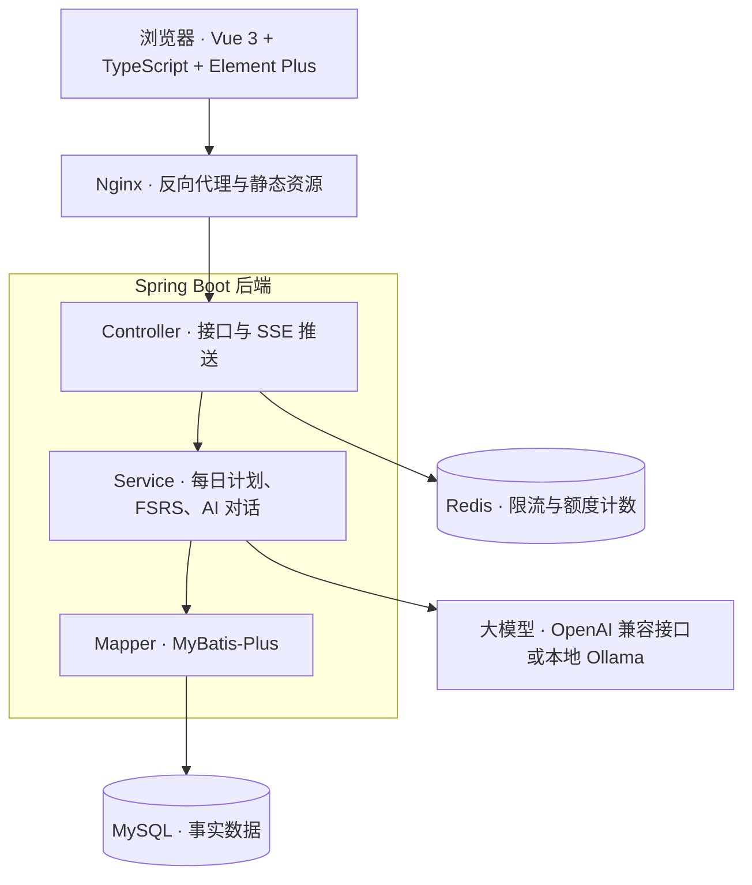
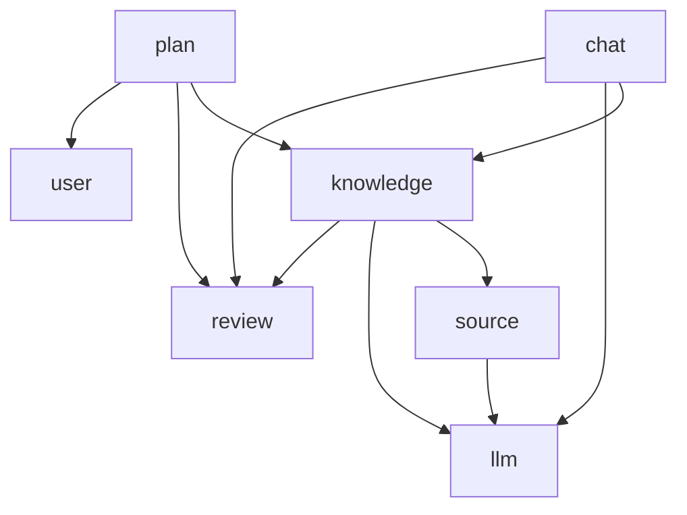

# 温故 · 技术方案 v0.1

本文档是 [PRD](./prd.md) 之后的技术层设计。

## 架构概览

**第一版是一个单体 Spring Boot 应用，按 Controller / Service / Mapper 三层分层。** 不拆微服务，部署和调试都最简单。



Redis 在接口入口处做限流；调用大模型和 FSRS 调度都在 Service 层，AI 的回复由 Controller 通过 SSE 逐字推给浏览器。

## 技术栈

原则：**选作者熟悉的技术，亮点放在产品设计和 AI 部分，不在技术栈上冒险。**

| 层 | 选型 | 理由 |
| --- | --- | --- |
| 后端框架 | Spring Boot 4，Java 21，Maven | 作者最熟悉，也贴合 Java 后端面试；Spring AI 2.x 要求 Spring Boot 4 |
| 持久层 | MyBatis-Plus + MySQL 8.4，Flyway 管理表结构 | 熟悉；MVP 不需要向量检索；表结构随代码版本化，见 [决策 009](./decisions/009-数据库迁移与表结构约定.md) |
| 测试数据库 | Testcontainers（MySQL 8.4） | 迁移脚本和时区处理要在真实的 MySQL 上测，H2 不可靠 |
| 安全 | Spring Security + JWT | 仅多用户模式启用 |
| 缓存 / 计数 | Redis | 只用于 AI 接口限流、线上免费额度计数，不做过早缓存 |
| 大模型接入 | Spring AI 2.0.1（OpenAI starter） | Spring 官方项目，用法与其他 starter 一致；兼容 OpenAI 格式与 Ollama，见 [决策 004](./decisions/004-大模型接入.md) |
| 流式输出 | SSE | 单向推送，比 WebSocket 简单 |
| 调度算法 | FSRS-6，从 py-fsrs 6.3.2 移植为 Java | 用 Python 版输出做单元测试校验，见 [决策 003](./decisions/003-FSRS移植.md) |
| 文档解析 | Apache PDFBox、Apache POI | PDF 与 DOCX 文字提取 |
| 前端 | Vue 3 + TypeScript + Vite + Element Plus | 上手平缓；TS 是前端主流，静态类型对 Java 背景更友好，也让 AI 写的代码更好读、错误在编译时暴露 |
| 部署 | Docker Compose + Nginx | 一条命令启动 |

## 包结构与分层约定

**按业务分包（模块化单体）**，每个模块内部再分 controller / service / mapper / entity / dto。

```
com.wengu
├── source      资料导入与解析
├── knowledge   知识点
├── plan        每日计划
├── review      评分与调度
│   └── fsrs    FSRS 算法（纯 Java）
├── chat        学习会话与对话
├── llm         大模型接入、降级链
├── user        用户与设置
└── common      统一返回、全局异常、工具类
```

约定：

- 模块之间只能调用对方的 Service，不能直接使用对方的 Mapper 或访问对方的表，为以后拆分保留边界
- review.fsrs 只放纯计算代码：不加 Spring 注解、不访问数据库，输入当前状态和评分、输出新状态，用 Python 版结果做单元测试
- 依赖方向单向，不允许循环依赖，完整关系见下图和 [决策 002](./decisions/002-模块依赖边界.md)
- review 只通过 kp_id 工作，不依赖 knowledge；知识点创建时由 knowledge 调用 review 初始化调度状态，结束评分时由 chat 调用 review 更新调度状态、写评分流水
- llm 是底层模块，管理 model_config，不依赖任何业务模块
- 当前用户 id 由 common 提供（单用户模式返回默认用户），各模块不为此依赖 user



所有模块都可以依赖 common，图中省略。

## 数据模型

所有业务表都带 user_id，单用户模式下只有一个默认用户（id 为 1，由迁移脚本 V1 插入），切换多用户时表结构不变。时间统一用 `DATETIME(3)` 存 UTC，枚举存名称，不建外键，约定见 [决策 009](./decisions/009-数据库迁移与表结构约定.md)。下表是 V1 建出的表，后续 issue 需要的字段由各自的迁移脚本添加。

| 表 | 作用 | 关键字段 |
| --- | --- | --- |
| user | 用户 | id、username、password_hash |
| user_settings | 用户设置 | user_id、daily_new_limit（每天新学数量，默认 3）、timezone（默认取环境变量 WENGU_TIMEZONE）、day_start_hour（一天的分界，默认 4 点） |
| source | 导入的学习材料 | id、user_id、type（题目 / 源码 / 文档 / 截图）、name、content（用户粘贴的原文，包括答案）、questions（切分出的题目 JSON，V2 添加，见决策 011） |
| knowledge_point | 知识点（很少变） | id、user_id、type（知识点类型，见下文）、title（写成一个问题）、summary、status（ACTIVE / SUSPENDED）、sort_order（新知识按 sort_order、id 派发）、来源草稿（待 #17 确定） |
| kp_source | 知识点与材料的多对多关联 | kp_id、source_id、user_id |
| card_state | 调度状态（每次复习都更新） | kp_id、user_id（冗余）、state（学习中 / 复习 / 重学）、step（学习步或重学步序号，复习状态为空）、due、stability、difficulty、last_review（为空表示新知识） |
| study_session | 一次学习会话，也是自动计时的来源 | id、user_id、kp_id、started_at、ended_at |
| message | 会话中的对话消息 | id、user_id、session_id、role、content、created_at |
| review_log | 每次评分的流水 | id、user_id、kp_id、session_id、rating_user、rating_ai、state_before、is_first_review（是否为该知识点的第一次学习）、reviewed_at |
| 抽取草稿 | 一次抽取的结果，用户确认后才生成知识点 | 保存模型的原始 JSON、prompt 版本、模型名；来源可以是导入批次，也可以是学习会话（候选知识点，见决策 008）；表结构待 #13、#15 确定 |
| model_config | 模型配置（M3；M1 用环境变量，见决策 007） | user_id、base_url、model、api_key_encrypted |

关键索引：

- card_state 建联合索引 (user_id, due)，用于查询“某用户所有到期的知识点”
- review_log 建联合索引 (user_id, reviewed_at)，用于统计今天已学的新知识和学习历史
- message 建索引 (session_id, created_at)，用于按顺序取出会话上下文

调度状态说明：

- state 与 FSRS-6 一致，只有学习中、复习、重学三种，没有单独的“新”状态。**新知识 = card_state 中 last_review 为空**（知识点创建时由 knowledge 调用 review 初始化，此时 state 为学习中）
- 不参与调度的类型不初始化 card_state，由 knowledge 在创建时决定：SYSTEM_DESIGN；M1 中还有 EXPERIENCE（见决策 007）
- 复习次数、遗忘次数不单独存储，需要时从 review_log 统计
- 项目默认没有学习步和重学步，每个知识点一天最多出现一次，见 [决策 003](./decisions/003-FSRS移植.md)

## 每日计划的计算逻辑

**每日计划不建表，每次打开时实时计算。** 它是派生数据，事实已经存在 card_state 和 review_log 里。

计算步骤：

1. 根据用户时区和 day_start_hour，算出“今天”的起止时间（换算成 UTC）。
2. 到期复习：review 查 card_state 中 user_id 匹配、**last_review 不为空**、且 due 早于今天结束时间的 kp_id。必须排除 last_review 为空的新卡片，否则新知识会被误当成到期复习。
3. 今天已学的新知识数：review 查 review_log 中今天范围内、**is_first_review 为真**的记录条数。不能用 state_before 判断：新卡片的 state 也是“学习中”。
4. 剩余新知识名额 = daily_new_limit − 第 3 步的数量，小于 0 时取 0。
5. 新知识候选：review 查 card_state 中 last_review 为空的 kp_id。
6. 过滤与排序：plan 把第 2、5 步的 kp_id 交给 knowledge，在内存中排除暂停的知识点、按排序字段排序；新知识取前“剩余名额”个。
7. 返回：到期复习列表 + 新知识列表，先复习后新学。

第 3 步是防止重复派发的关键：如果不扣除今天已学的新知识，用户下午再打开页面时会被重新分配一批新知识，每日上限就失效了。

复习完的知识点 due 会被推到未来，自然不会再出现在第 2 步的结果里，无需额外处理。

查询分在 review 和 knowledge 两个模块中完成，各自只读自己的表；SYSTEM_DESIGN（M1 中还有 EXPERIENCE）没有 card_state，自然不会进入计划。第 6 步在内存中处理，是 MVP 只有几百个知识点时的取舍，见[决策 002](./decisions/002-模块依赖边界.md)。

## 关键设计决策

每条决策写清楚选了什么、为什么、放弃了什么，方便以后回顾和面试复述。新的决策记录在 `docs/decisions/` 下。

| 决策 | 理由 | 放弃的方案 |
| --- | --- | --- |
| 存事实，算派生：每日计划实时计算 | 避免两份数据不同步；查询有索引，毫秒级 | 建 daily_plan 表存快照 |
| card_state 与 knowledge_point 拆开 | 内容很少变，调度状态频繁更新，职责不同；FSRS 字段可能随算法升级变化 | 合并成一张表 |
| card_state 冗余 user_id | 有意识的反范式，用一点冗余换取 (user_id, due) 单索引查询 | 每次关联 knowledge_point 筛选用户 |
| 状态表与流水表分离 | card_state 存“现在”，review_log 存“全部历史”，供统计和 FSRS 参数优化 | 只更新状态，不留历史 |
| 评分以用户确认为准，同时记录 AI 建议 | 用户最了解自己；保留差异以后可评估 AI 准确度 | 完全由 AI 评分 |
| 单用户 / 多用户同一套代码，用配置切换 | 只维护一个版本；默认单用户，开箱即用 | 维护两个分支 |
| Flyway 管理表结构，字段随 issue 增量添加 | 空库启动即建好表，每次改动有记录；实现前不预先猜字段，见 [决策 009](./decisions/009-数据库迁移与表结构约定.md) | 手写 SQL 手动执行；V1 一次建好所有字段 |
| “现在”从注入的 Clock 获取 | 测试中可以换成固定时间，覆盖“今天”的边界 | 直接调用 Instant.now() |
| Redis 只用于限流和额度计数 | 这些场景需要高频读写计数器；每日计划无需缓存 | 缓存每日计划（过早优化） |
| 流式输出用 SSE | AI 回复是单向推送，SSE 实现简单 | WebSocket |
| 题目切分交给模型：只输出题目原文，程序逐字核对，temperature 0；导入分两步，先预览再抽取 | 真实资料格式很乱（表格、带答案、网页复制），规则写不全；逐字核对能查出改写和编造，见 [决策 011](./decisions/011-题目切分交给模型.md) | 规则切分；切分合并进抽取 prompt |
| 知识点抽取：整批题目一次请求，先输出主题分组再输出知识点，temperature 0.2 | 一次请求才能跨题合并；分组字段迫使模型先判断重叠；低 temperature 让结果可复现，见 [决策 005](./decisions/005-知识点抽取实现.md) | 逐题调用；两步调用；默认 temperature |
| 按业务分包，FSRS 独立为纯 Java 子包 | 功能代码集中、依赖清晰、便于以后拆分；算法与副作用分离，方便单元测试 | 按层分包 |
| 自行移植 FSRS-6，状态模型与 py-fsrs 一致，默认无学习步 | 逐条比对 Python 结果；新知识用 last_review 为空表示；知识点是几分钟的 AI 对话，不宜当天重复 | 引入现成 Java 库；增加 NEW 状态；保留分钟级学习步 |

## 知识点粒度与类型

本节基于对 200 道 Java 后端面试题的分析。

**粒度标准：一个知识点 = 能在 3～5 分钟对话里讲清、用一个问题就能检验的概念。** 以面试的提问方式为参照：一道题和它的常见追问构成一条追问链，主问题和每个追问各算一个知识点。

抽取规则：

- **拆分**：原理类大题按追问链拆成多个知识点，其中必须有一个讲整体流程的主干，排在细节之前，例如 HashMap 原理拆为整体结构与 put 流程、引入红黑树的原因、负载因子、扩容机制等
- **合并**：问法不同、考的是同一内容的题合并为一个知识点，通过 kp_source 关联所有来源题，例如“说说 TCP 的四次挥手”和“TCP 断开连接的过程是怎样的”
- **小追问不拆**：“是什么”加上一两句就能答完的直接追问，合为一个知识点；追问本身是完整机制时才拆开。一两句就能答完的“是什么”题，并入以它为前提的另一道题
- **摘要不越界**：摘要只覆盖原题和它的直接追问；原题限定了角度的（如“从网络角度”），不讲角度之外的内容
- **包含不算重复**：一个流程包含另一个流程时不合并，分别输出，先排作为基础的那个，例如“Spring refresh 流程”和“Spring Boot 启动流程”
- **排序**：AI 按学习顺序输出知识点，确认时写入 knowledge_point 的排序字段，新知识按排序字段派发，暂不建依赖关系表

M0 用 30 道样本题验证，人工修改约 12%，达到验收标准；抽取 prompt 第一版为 v5，已知问题是大题的细节知识点常被主干代替，MVP 之后改进（#9）。详见 [决策 006](./decisions/006-知识点粒度标准与抽取prompt第一版.md)。

知识点类型（knowledge_point.type）：

| 类型 | 枚举值 | 识别特征 | 学习与复习方式 |
| --- | --- | --- | --- |
| 原子概念 | CONCEPT | 单一概念，如回表、CAS | 对话讲解，复习时换角度提问 |
| 对比 | COMPARISON | “A 和 B 的区别” | 追问差异和各自适用场景 |
| 原理机制 | MECHANISM | 流程或原理，常带追问链 | 深度对话，按顺序学习 |
| 列举 | ENUMERATION | “有哪些” | 偏记忆，快问快答 |
| 排查实战 | TROUBLESHOOTING | “线上出了问题怎么办” | 情景模拟，考察步骤和工具 |
| 系统设计 | SYSTEM_DESIGN | “设计一个 XX 系统” | 综合多个知识点；M1 只标记、不进入每日计划，以后做模拟面试 |
| 个人经历 | EXPERIENCE | “你项目里怎么做的” | 必须结合用户源码追问；M1 只标记、不进入每日计划，M2 有源码导入后启用 |

加 type 字段的理由：不同类型的复习方式差别很大，用类型选择不同的对话 prompt，成本几乎为零，却直接决定学习体验。

## 学习对话与评分建议

一次学习分两段，详见 [决策 008](./decisions/008-学习对话与评分建议prompt第一版.md)：

| 阶段 | 流程 | 评分 |
| --- | --- | --- |
| 主线 | 摸底 → 讲解 → 检验 → 追问 → 完整作答 → 收尾，建议 4～6 次回答；第 7 次回答后要求完整作答，第 8 次后要求收尾 | 收尾后调用评分建议，用户确认后交给 FSRS |
| 接着问 | 收尾后学生自由提问，老师只回答、不出题，设一个防失控的上限 | 不评分 |

- 学习对话 prompt：`prompts/learning-chat-v2.md`。知识点信息放在第一条用户消息里，system prompt 不变；收尾时输出“【学习结束】”作为结束标记
- 评分建议 prompt：`prompts/rating-suggestion-v3.md`。以完整作答为主要依据、以知识点要点为标准，输出 `analysis`、`outOfScopeGaps`、`rating`、`weakPoints`（Spring AI 按字段名字母顺序生成 Schema，模型也按这个顺序输出，所以依据排在第一个）
- `weakPoints` 供复习时针对性提问（#21）；`outOfScopeGaps` 和“接着问”中的新内容在学完后成为候选知识点，复用草稿确认流程（#15、#17）
- 用户确认的评分为准，AI 建议的评分同时记录

## 接口

所有接口返回统一格式 `{code, message, data}`（决策 001）。每个 issue 完成后把自己的接口补到这里。

| 接口 | 作用 | 请求 | 返回 data | 说明 |
| --- | --- | --- | --- | --- |
| `POST /api/sources` | 导入面试题并切分（#15） | `{name, content}` | `{id, name, questions: [{id, text, followUps}]}` | 调用模型，耗时几秒到十几秒；原文不超过 30000 字、切分后不超过 30 题，否则返回 400 和处理建议；切分重试后仍失败返回 502 `QUESTION_SPLIT_FAILED`。见决策 011 |

## 待补充

- [ ] 接口设计：各模块的 URL、参数和返回值。不在开工前一次定完，每个 issue 在方案中确定自己的接口，完成后汇总到本文档（见决策 007）
- [x] 知识点抽取、学习对话、评分建议三类 prompt 的设计：抽取见决策 006，学习对话与评分建议见决策 008
- [x] 后端包结构与分层约定
- [x] M0 结论：用 30 道样本题验证粒度标准和类型判断，见决策 006
